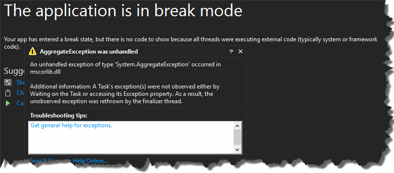

### 1\. Introduction

Working with _Tasks_ is a modern way of writing asynchronous code in an easy and flexible manner. It is quite straightforward to start using them, so usually developers do not investigate thoroughly the topic. Unfortunately this often leads to unpleasant surprises - especially when it comes to exception handling. Having this in mind let's take a look how to handle exceptions in _Task_ and what can happen if we do it wrong.

### 2\. Exception handling

Because of the fact that _Tasks_ are run asynchronously we can't just use a standard _try catch_ block surrounding _Task_

```
public static void TryCatchBlockWrongWay()
{
    try
    {
        Task.Factory.StartNew(() => { throw new Exception("From method TryCatchBlockWrongWay"); });
    }
    catch (Exception ex)
    {
        // this will never be hit
        Console.WriteLine("Exception handled {0}", ex);
    }
}

```

In that case catch block is unreachable (I will describe later what happens with that exception), of course we could use _try catch_ inside _Task.Factory.StartNew_ lambda expression but this is not always the case. Usually we want to handle exception in the caller of the _Task_, not inside the _Task_ itself. There are couple of ways of achieving that - depending on the situation you can use one of the following ways. Exception are propagated to caller once you start waiting for the result of _Task_. So basically you can use _try catch_ block if you wait for a _Task_ to finish - either by accessing _Result_ property or using _Wait_ method

```
public static void HandleExceptionTryCatchResult()
{
    try
    {
        var task = Task.Factory.StartNew(() =>
        {
            throw new Exception("From method HandleExceptionTryCatchResult");
            return 1;
        });
        // do more stuff while task is running
        // do more stuff while task is running
        // do more stuff while task is running
        var result = task.Result;
    }
    catch (Exception ex)
    {
        Console.WriteLine("HandleExceptionTryCatchResult: exception handled in try catch block. Exception is {0}", ex);
    }
}

public static void HandleExceptionTryCatchWait()
{
    try
    {
        var task = Task.Factory.StartNew(() => { throw new Exception("From method HandleExceptionTryCatchWait"); });
        // do more stuff while task is running
        // do more stuff while task is running
        // do more stuff while task is running
        task.Wait();
    }
    catch (Exception ex)
    {
        Console.WriteLine("HandleExceptionTryCatchWait: exception handled in try catch block. Exception is {0}", ex);
    }
}

```

However accessing _Result_ or calling _Wait_ method are blocking calls, so this might not be a perfect solution for every scenario. Fortunately we can also leverage _ContinueWith_ method which gives you an ability to specify what should be done once _Task_ finishes processing the operation. What is more important you can configure this method to only be called if exception occurs. Nonetheless there is one crucial thing you have to remember - in order to make exception handled or observed you have to access _Exception_ property of _Task_...

```
public static void HandleExceptionContinueWith()
{
    Task.Factory.StartNew(() => { throw new Exception("From method HandleExceptionContinueWith"); })
                .ContinueWith(val =>
                {
                    // we need to access val.Exception property otherwise unobserved exception will be thrown
                    // ReSharper disable once PossibleNullReferenceException
                    foreach (var ex in val.Exception.Flatten().InnerExceptions)
                    {
                        Console.WriteLine("HandleExceptionContinueWith: exception handled in ContinueWith. Exception is {0}", ex);
                    }
                }, TaskContinuationOptions.OnlyOnFaulted);
}

```

or call _Handle_ method from _AggregateException_ object

```
public static void HandleExceptionContinueWithAndHandleMethod()
{
    Task.Factory.StartNew(() => { throw new Exception("From method HandleExceptionContinueWith"); })
                .ContinueWith(val =>
                {
                    val.Exception.Handle(ex =>
                    {
                        Console.WriteLine("HandleExceptionContinueWith: exception handled in AggregateException.Handle. Exception is {0}", ex);
                        return true;
                    });
                }, TaskContinuationOptions.OnlyOnFaulted);
}

```

Otherwise exception will not be handled which may cause a lot of troubles described in section 3 of this post. Lastly if you use _.NET 4.5_ you can also just use _async await_ and _try catch_ block

```
// called from Main
public static async void HandleExceptionTryCatchAwait()
{
    try
    {
        await HandleExceptionTryCatchAwaitInternal();
    }
    catch (Exception ex)
    {
        Console.WriteLine("HandleExceptionTryCatchAwait: exception handled in try catch block");
    }
}

private static async Task HandleExceptionTryCatchAwaitInternal()
{
    return await Task.Factory.StartNew(() =>
    {
        throw new Exception();
        return 1;
    }, TaskCreationOptions.LongRunning);
}

```

### 3\. Handling UnobservedTaskException

If it happens that exception thrown by _Task_ is not handled, once the _Task_ is garbage-collected, finalizer thread will throw _UnobservedTaskException_.

```
Task.Factory.StartNew(() => { throw new Exception("fire-and-forget no exception handling"); });
using (var autoresetEvent = new AutoResetEvent(false))
{
    //wait for task to run
    autoresetEvent.WaitOne(TimeSpan.FromSeconds(2));
}

Console.WriteLine("GC: Collecting");
GC.Collect();
GC.WaitForPendingFinalizers();
Console.WriteLine("GC: Collected");

```

The implication of this depends on framework we are running our application on. If you run your app on _.NET 4.5_ or later version, with default escalation policy, _TaskScheduler.UnobservedTaskException_ event will be raised and basically that is all. No more further problems, so basically you may not even realize that there is something like _UnobservedTaskException_. However if we add this entry

to _app.config_our process will be killed once _UnobservedTaskExceptionis_ is thrown. [](http://tpodolak.com/blog/wp-content/uploads/2015/08/tpl-exception-handling-and-unobservedtaskexception-issue/ProcessKilled.png) The problem arises in _.NET 4.0_ (if you run your app on _.NET 4.0_ not only compile it against this framework version), in this version of framework default escalation policy is very strict and will kill our process once the _UnobservedTaskException_ is thrown by finalizer thread. Furthermore you cannot change this policy using _app.config_. Fortunately there is a one last chance to handle UnobservedExceptions and prevent our process from being killed. All you have to do is to wire up _TaskScheduler.UnobservedTaskException_ static event handler and then set exception to observed state

```
TaskScheduler.UnobservedTaskException += TaskScheduler_UnobservedTaskException;
private static void TaskScheduler_UnobservedTaskException(object sender, UnobservedTaskExceptionEventArgs e)
{
    e.SetObserved();
}

```

There is one more thing to clarify. You can compile your library against _.NET 4.0_ but if you have _.NET 4.5_ installed on your machine, your application is launched and run on _.NET 4.5_. This means that escalation policy from _.NET 4.5_ will be used - so by default process will not be killed. In order to simulate pure _.NET 4.0_ behavior while having _.NET 4.5_ installed you have to add

in your _app.config_ as it was mentioned before. Otherwise you would have to uninstall _.NET 4.5_ in order to, for example reproduce production issue. Source code for this post can be found [here](https://github.com/tpodolak/Blog/tree/master/HandlingUnobservedTaskExceptions)
