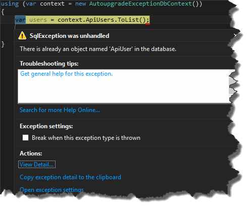
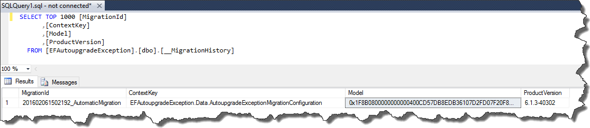

Recently I've been doing some small refactoring of my pet project. Nothing too fancy - just namespace adjustment, variables and class renaming etc.
However it turned out that even these minor changes can in fact be major ones.
All of the sudden most of my integration tests started failing due to `SQLException`.

[](http://tpodolak.com/blog/wp-content/uploads/2016/02/entityframework-sqlexception-during-database-migration/Exception.png)

I am using `Code First` approach so I didn't take me too much time to realize that for some reasons `EntityFramework` wanted to create already existing tables.
I started looking into the way `EF` keeps track of the changes in the model and it turned out that it creates special table called `__MigratoinHistory`

[](http://tpodolak.com/blog/wp-content/uploads/2016/02/entityframework-sqlexception-during-database-migration/ContextKey.png)

One of the most important columns in there is column called `ContextKey`, which identifies the class which describes migration policy.
In my case this class originally looked that way

```csharp
namespace EFAutoupgradeException.Data
{
    public class AutoupgradeExceptionMigrationConfiguration : DbMigrationsConfiguration<AutoupgradeExceptionDbContext>
    {
        public AutoupgradeExceptionMigrationConfiguration()
        {
            this.AutomaticMigrationsEnabled = true;
            this.AutomaticMigrationDataLossAllowed = true;
        }
    }
}
```

In that case value of the `ContextKey` column matches the full name of the class

```csharp showLineNumbers=false
EFAutoupgradeException.Data.AutoupgradeExceptionMigrationConfiguration

```

The class after refactoring was slightly changed and now it looks that way

```csharp
namespace EFAutoupgradeExceptions.Data
{
    public class AutoupgradeExceptionMigrationConfiguration : DbMigrationsConfiguration<AutoupgradeExceptionDbContext>
    {
        public AutoupgradeExceptionMigrationConfiguration()
        {
            this.AutomaticMigrationsEnabled = true;
            this.AutomaticMigrationDataLossAllowed = true;
        }
    }
}
```

It is easy to overlook the change but now, full name of the class is

```csharp
# Exceptions as in plural compared to singular previously
EFAutoupgradeExceptions.Data.AutoupgradeExceptionMigrationConfiguration
```

so `EF` loses the information about the migration and tries to migrate once again from the scratch.
Fortunately there is an easy fix for that which doesn't require dropping the database.
All you have to do is to write simple update statement which set the proper `ContextKey` value.

```sql
USE EFAutoupgradeException
UPDATE [__MigrationHistory]
SET
[ContextKey] = 'EFAutoupgradeExceptions.Data.AutoupgradeExceptionMigrationConfiguration'
WHERE [ContextKey] LIKE '%AutoupgradeExceptionMigrationConfiguration'

```

Source code for this post can be found [here](https://github.com/tpodolak/Blog/tree/master/EntityFrameworkAutoupgradeException)
