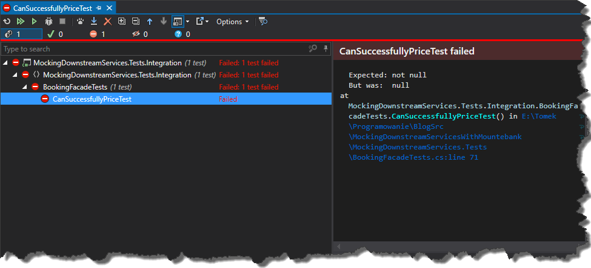
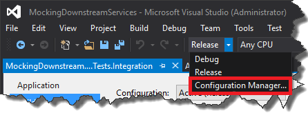
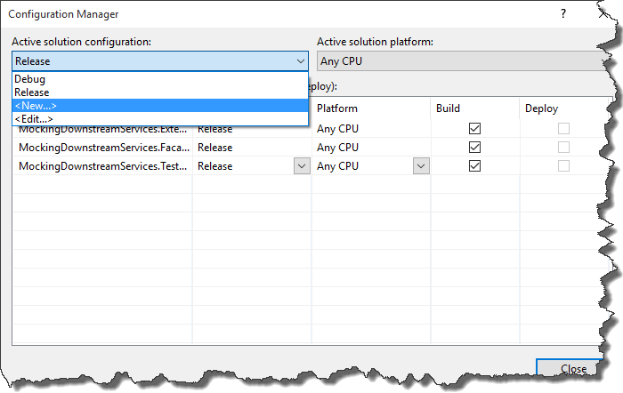
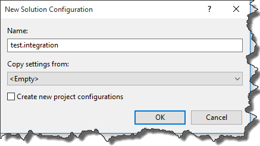
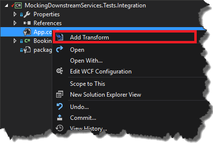
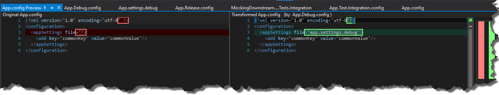
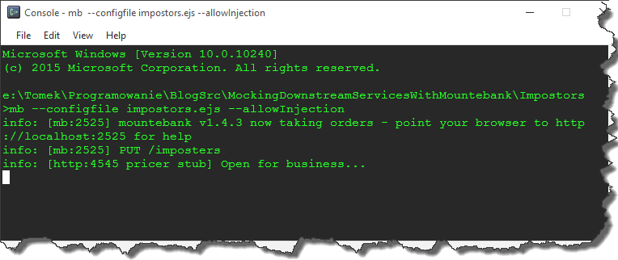
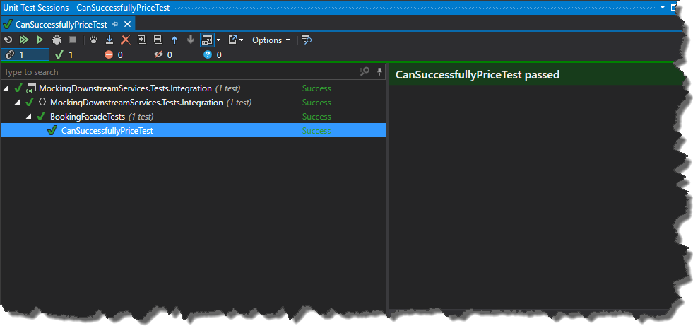

### 1\. Introduction

I'm a part of a team which creates large enterprise platform for the banking sector. Due to the fact that we operate in the financial area, our application consumes a high amount of downstream services. One of the major problems we are facing at the moment is the inaccessibility of those services on _DEV_ and _UAT_ environments. It often happens that one of those services is down for quite some time, so our development speed is impaired. The bigger problem, however, is the fact that our end-to-end tests are red. Having a red test on _TeamCity_ for a long time is a really annoying thing because basically at this point, we just automatically assume that all of the failures are caused by issues with downstream systems. Fortunately, we finally decided to get rid of this problem and this is the solution we came up with.

### 2\. Background

Before I go to the implementation details, take a look at a sample implementation of situation I described at the very beginning. Let's assume that we have _WCF_ service which contains business logic of our application and it is consumed by the _UI_ side

```
public class BookingFacade :  IBookingFacade
{
    public Response Price(Models.GetPriceRequest request)
    {
        // in real life scenario Pricer should be injected
        var pricerService = new Pricer();
        var response = new Response();
        try
        {
            var tradingDates = pricerService.GetTradingDates();
            var price = pricerService.GetPrice(new GetPriceRequest
            {
                IsAdvised = request.IsAdvised
            });

            // rest of the code omitted for brevity
            response.Result = new Price
            {
                TradingDates = new TradingDates
                {
                    MaturityDate = tradingDates.MaturityDate,
                    SettlementDate = tradingDates.SettlementDate
                }
            };
            // rest of the code omitted for brevity
        }
        catch (Exception ex)
        {
            // rest of the code omitted for brevity
        }
        return response;
    }
}

```

_BookingFacade_ uses _Pricer_ service which basically is just a wrapper for external/downstream service we have to use in order to retrieve some data (and we do not have an ownership of that service).

```
public class Pricer : IPricer
{
    public TradingDates GetTradingDates()
    {
        using (var webClient = new WebClient())
        {
            var result = webClient.DownloadString(ConfigurationManager.AppSettings["MockingDownstreamServices.Externals.Pricer.GetTradingDates"]);
            return JsonConvert.DeserializeObject(result);
        }

    public Price GetPrice(GetPriceRequest request)
    {
        using (var webClient = new WebClient())
        {
            var result = webClient.UploadString(ConfigurationManager.AppSettings["MockingDownstreamServices.Externals.Pricer.GetPrice"], JsonConvert.SerializeObject(request));
            return JsonConvert.DeserializeObject(result);
        }
    }
}

```

Very simple end-to-end test for _BookingFacade_ can look like that

```
[TestFixture]
public class BookingFacadeTests
{
    [Test]
    public void CanSuccessfullyPriceTest()
    {
        var response = this.Price(new GetPriceRequest());
        Assert.IsNotNull(response);
        Assert.IsNotNull(response.Result);
        Assert.IsFalse(string.IsNullOrWhiteSpace(response.Result.Id));
        CollectionAssert.IsEmpty(response.Messages.Where(val => val.StatusCode == StatusCodes.Error));
    }
}

```

As I mentioned before, everything is fine as long as all of the downstream systems are working. The moment one of them is down, our tests start failing. [](//tpodolak.com/blog/wp-content/uploads/2016/02/mocking-downstream-services-with-mountebank-part-one/FailingTests.png)

### 3\. Implementation

General idea to fix this problem is to use fake downstream systems during end-to-end testing. In order to do that we use combination of custom compilation profile, _app.config_ transformations and [mountebank](http://www.mbtest.org/) test doubles.

#### 3.1 Setting up transformations

First of all we will create a custom compilation profile called _test.integration_ which will be used for running tests with mocked downstream systems (we want to preserve the normal use of downstreams for _Debug_ and _Release_ mode). In order to do that, go to _ConfigurationManager_ [](//tpodolak.com/blog/wp-content/uploads/2016/02/mocking-downstream-services-with-mountebank-part-one/ConfigurationManager.png) and follow the steps presented in the pictures below [](//tpodolak.com/blog/wp-content/uploads/2016/02/mocking-downstream-services-with-mountebank-part-one/ConfigurationManager2.png) [](//tpodolak.com/blog/wp-content/uploads/2016/02/mocking-downstream-services-with-mountebank-part-one/ConfigurationManager3.png)

Now it is time to prepare our _app.config_ for transformations. We can do it manually but for sake of simplicity I will use _SlowCheetah_ extension. Go to _Tools->Extensions and Updates_ and install [SlowCheetah - XML Transforms](https://visualstudiogallery.msdn.microsoft.com/69023d00-a4f9-4a34-a6cd-7e854ba318b5). Once extension is installed you will see a _Add Transform_ item in a config files' context menu. [](//tpodolak.com/blog/wp-content/uploads/2016/02/mocking-downstream-services-with-mountebank-part-one/AddTransform.png) Clicking _Add Transform_ will create three files: _App.Debug.config_, _App.Release.config_ and _App.Test.Integration.config_. What is more, some additional changes will be added to your _csproj_ file, which will be responsible for applying transformations during a build process. These three additional files hold information about config transformations. The default _App.config_ file looks like that

Nothing special in here but note the empty _file_ attribute in _appSettings_ node. The value of this attribute will be replaced with proper filename during transformation process. In order to do that let's implement tramsforms for every of three config files we use

**_App.Debug.config_**

**_App.Release.config_**

**_App.Test.Integration.config_**

As you can see I apply _SetAttributes_ transform for _appSettings_ node, which means that the transformation will replace _appSettings_ node attributes from _app.config_ file with _appSettings_ node attributes from transform file. You can preview results of transformation by clicking _Preview Transform_ context menu option available for every of our transform files [](//tpodolak.com/blog/wp-content/uploads/2016/02/mocking-downstream-services-with-mountebank-part-one/Preview.png) As you've probably already figured it out _app.settings.debug_ and _app.settings.release_ fileses contain real downstream endpoints and _app.settings.tests.integration_ contains addresses of fake endpoints. Of course you have to create those files and copy them to output directory during the build (for instance by using _Copy to Output directory_ option).

#### 3.2. Creating fake downstreams with mountebank

Setting up fake downstream systems completely from scratch would be a very painful and time consuming process. Fortunately there are tools which can make this task easier. The tool I use is called [mountebank](http://www.mbtest.org/) - you can easily install it via _npm_

```
npm install -g mountebank

```

Having _mountebank_ on board it is time to configure it, so that it acts as fake _Pricer_ service. It can be done in couple of ways but I will go with file based configuration. You can run the tool using following command

```
mb --configfile impostors.ejs --allowInjection

```

[](//tpodolak.com/blog/wp-content/uploads/2016/02/mocking-downstream-services-with-mountebank/ImpostorsListening.png) Where _impostors.ejs_ is a configuration file with following structure

```
{
  "imposters": [
    <% include pricer.json %>
  ]
}

```

_<% include pricer.json %>_ is _[EJS](http://www.embeddedjs.com/)_ syntax which (in this case) allows you to split configuration into multiple files. As you've probably already figured it out, _Pricer.json_ contains the actual mock configuration for _Pricer_ service. The initial mock object consists of couple of properties which setup the name, port and protocol for given mock.

```
{
  "port": 4545,
  "protocol": "http",
  "name": "pricer stub",
  "stubs": []
}

```

Note that we do not specify the address of mock but just a port. _Mountebank_ by default runs on _http://localhost:2525_ and mocks listen on _http://localhost:{port}_. The actual magic happens in _stubs_ property. Here is an example of stub/mock for _GetTradingDates_ method.

```
{
    "responses": [
      {
        "is": {
          "body": {
            "MaturityDate": "2016-02-17",
            "SettlementDate": "2012-02-23"
          }
        }
      }
    ],
    "predicates": [
      {
        "equals": {
          "path": "/GetTradingDates",
          "method": "GET"
        },
      }
    ]
}

```

As you can see stub object consists of two properties

- responses
- predicates

**_responses_** property is an array of objects _mountebank_ will be using to create a response. If you insert multiple items into array, they will be utilized using round robin algorithm. Note that you don't have to create a full response (with all the headers etc.) just use "is" property which will fill the default values for you. More about that topic can be found [here](http://www.mbtest.org/docs/api/stubs) but in most of the cases setting value for "body" property will be enough for you.

**_predicates_** property is an array of predicates which will be used during matching process. Predicate object can be quite complex, it supports lots of different matching techniques. In this case, for simple _GET_ method I just use _equals_ operator to match _HTTP_ verb and _HTTP_ method. The same technique can be used for stubbing _POST_ methods. However, in this case, you can also perform matching against the body of the request. The one thing you have to remember is that _body_ property is not an object but string. So in my case, if I want to make a stub for _GetPrice_ which takes as params following request object

```
public class GetPriceRequest
{
    public bool IsAdvised { get; set; }
}

```

I can write for instance this stub

```
{
    "responses": [
      {
        "is": {
          "body": {
            "Id": "1",
            "Strike": "1"
          }
        }
      }
    ],
    "predicates": [
      {
        "equals": {
          "path": "/GetPrice",
          "method": "POST",
          "body": "{\"IsAdvised\":false}"
        }
      }
    ]
}

```

Of course for more complex request it is pointless to write every possible combination of params. Fortunately you can create fallback/default stub which will match everything

```
{
    "responses": [
      {
        "is": {
          "body": {
            "Id": "default",
            "Strike": "1"
          }
        }
      }
    ],
    "predicates": [
      {
        "equals": {
          "path": "/GetPrice",
          "method": "POST"
        }
      }
    ]
}

```

If you put this at the very end of stubs array it will not interfere with other stubs. This is of course just a tip of the iceberg when it comes to predicate matching. Explanation of all possible matching options can be found [here](http://www.mbtest.org/docs/api/predicates)

### 4\. Results

From now on running tests against _test.integration_ compilation profile and having _mountebank_ working in the background, our tests will be green. [](//tpodolak.com/blog/wp-content/uploads/2016/02/mocking-downstream-services-with-mountebank/SuccessfulTests.png) Source code for this post can be found [here](https://github.com/tpodolak/Blog/tree/master/MockingDownstreamServicesWithMountebank)
