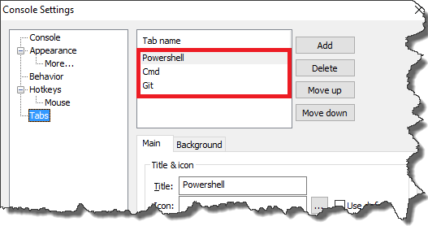
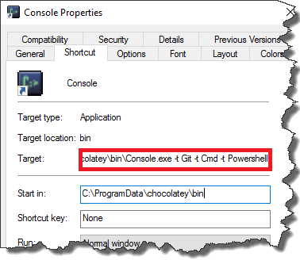

I've been using _Console2_ for quite some time and as for now it is my favorite command line terminal. The one thing I like the most is availability to use multiple tabs you can easily switch between. By default _Console2_ starts with only one tab opened, which was a bit of a pain for me. Mainly because I work a lot with Git and I also like to have a Visual Studio command prompt opened. So basically every time I launched command line I had to open one or two additional tabs. Fortunately it is quite easy to launch multiple tabs on startup. All you have to do is to create a shortcut to the _Console2_ with proper flags. Say for example I have following tabs defined [](http://tpodolak.com/blog/wp-content/uploads/2016/04/console2-multiple-tabs-startup/Settings.png)

I can start _Console2_ with all these tabs opened on startup using following command.

```bat
PATH_TO_CONSOLE\Console.exe -t Git -t Cmd -t Powershell

```

Of course it is easier to define a shortcut to _Console2_ rather than remembering command above. My configuration looks like that [](http://tpodolak.com/blog/wp-content/uploads/2016/04/console2-multiple-tabs-startup/Properties.png)
