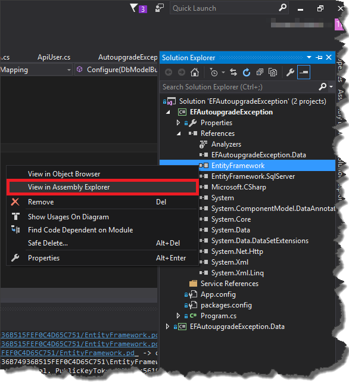
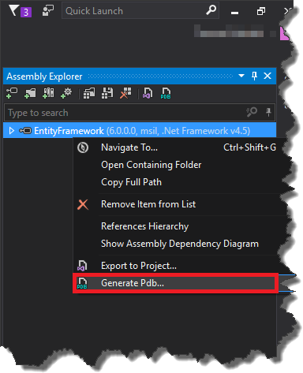
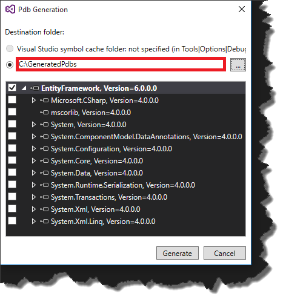
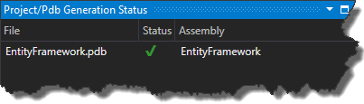
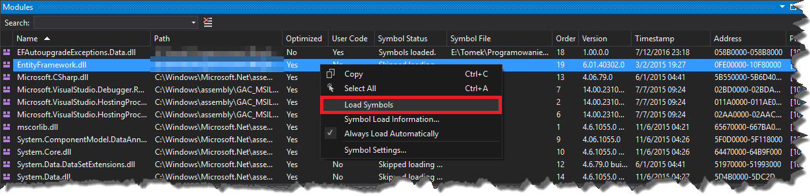
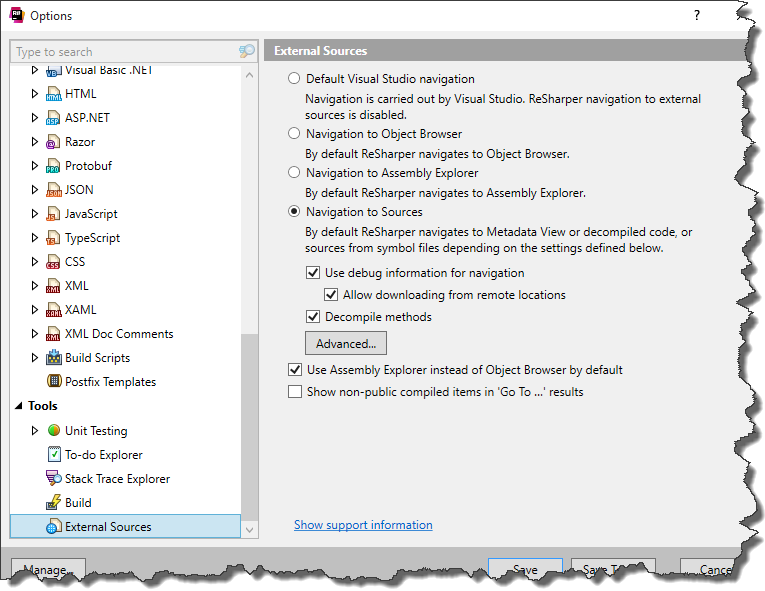
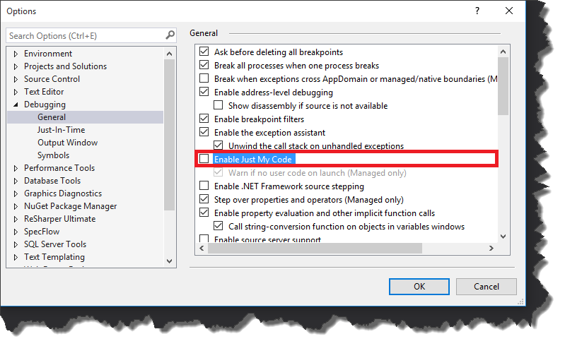
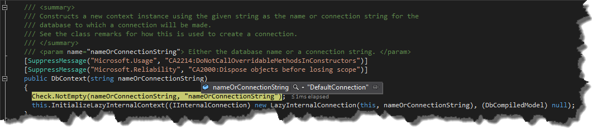

The majority of the libraries developers use in their projects these days are open source. So in case something crashes inside third party library or you just want to know how it works, it is possible to get the _PDB_ files from _Microsoft Symbols Servers_ and debug it. If for some reasons _PDB_ cannot be found on the servers, you can always grab the source code from _GitHub_ and add to your project manually. Unfortunately when you use commercial libraries, it is impossible to do any of the previous steps. Luckily with _Resharper_ you are able to generate _PDB_ files from assembly and use it later in _Visual Studio_ to debug it. Let's assume we would like to generate _PDB_ files for _EntityFramework_. First of all, we have to locate _EntityFramework_ assembly in _Assembly Explorer_. Go to _Solution Explorer_, _RMB_ click on assembly you are interested in and select _View in Assembly Explorer_.  In _Assembly Explorer_ once again _RMB_ click on _EntityFramework_ and select "_Generate Pdb…_"  In the opened window, select the destination folder for the files.  Once you click "_Generate_", _Resharper_ will process the assembly and generate _PDBs_.  Once the files are generated we have to tell _Visual Studio_ to use them. In order to do that, run the app and stop the execution with some breakpoint, then go to _Debug->Windows-> Modules_, locate _EntityFramework.dll_, click it with _RMB_, select "_Load Symbols_" and choose file(s) generated by _Resharper_.  A this point we have _PDB_ files ready but we are not able to set any breakpoint as we don't have source code of _EntityFramework_. Fortunately _Resharper_ once again saves the day as it is able to navigate to decompiled sources. Just make sure that your settings (_Resharper->Options->External Sources_) are the same as in the picture below  and you can navigate to external libraries' source code just like they were in your project. The very last step is to disable "_Enable Just My Code_" option in _Tools->Options->Debugging->General_  and from now on you can debug the external library 
