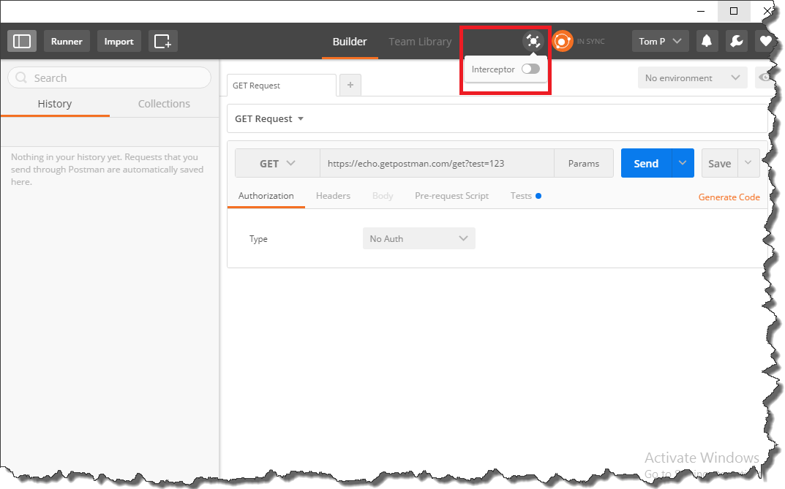
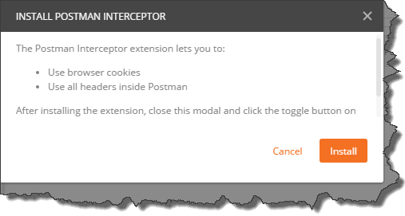
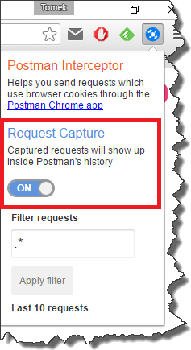
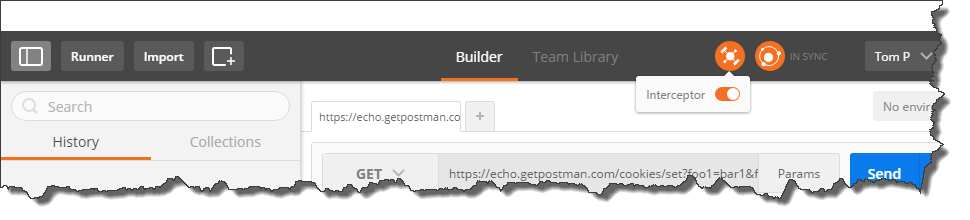
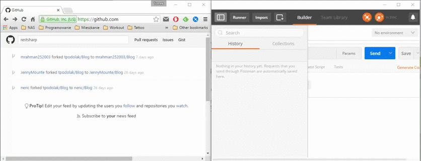

If you are doing any kind of rest api development you probably have heard of _Postman_. Long story short, it is a _Chrome_ extension which allows you to send http requests in a very easy and intuitive way. Apart from that (and many other features), it also allows you to intercept browser request. As this feature is very easy to overlook, here is a simple guide how to use it. In the _Postman_ window, click little satellite look-like button and toggle the "Interceptor" switch  _Postman_ will ask you to install additional plugin called _Postman Interceptor_  Once you click "Install" you will be redirected to _Chrome Web Store_ where you can add the plugin to the browser. After successful installation you will see additional icon in _Chrome_ menu bar. Click it and toggle "Request capture" switch  When you go back to _Postman_ and toggle again "Interceptor" button, it will be synchronized with _Postman Interceptor_ plugin  and from now on, requests sent by browser will be visible in requests history  where you will be able to modify and resend them.
