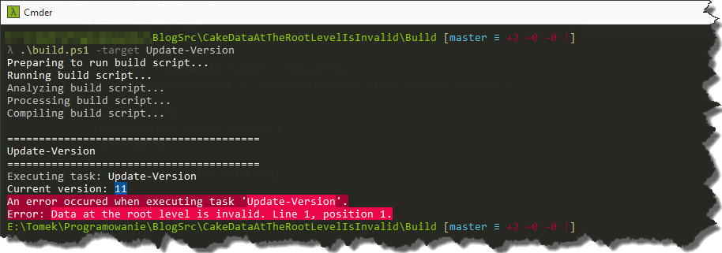
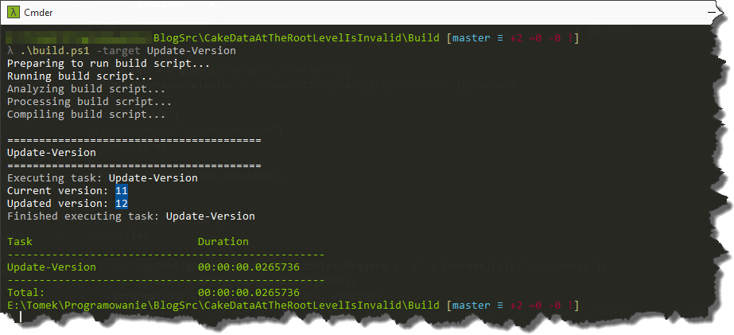

Couple of weeks [ago](http://tpodolak.com/blog/2016/07/10/debugging-cake-scripts/) I mentioned that in my current project we use `Cake` as a build mechanism.
Recently we wanted to add simple functionality to our build script, which would allow us to modify one of the `App.config`'s properties.
According to the documentation it should be a straightforward tasks, as all the heavy lifting can be done via `XmlPeek` and `XmlPoke` aliases.

Our initial script looked as follows

```csharp
Task("Update-Version")
.Does(()=>
{
    var appConfigPath = paths.Directories.Project + "/" + Context.File("App.config");
    var version = GetVersion(appConfigPath);
    Information("Current version: {0}", version);
    XmlPokeString(File(appConfigPath), xPathVersionSelector, (++version).ToString());
    version = GetVersion(appConfigPath);
    Information("Updated version: {0}", version);
});

private int GetVersion(string appConfigPath)
{
    return int.Parse(XmlPeek(appConfigPath, xPathVersionSelector));
}
```

And what was surprising for us, it didn't work.

[](http://tpodolak.com/blog/wp-content/uploads/2016/09/cake-data-at-the-root-level-is-invalid/DataAtTheRootLevel.png)

We got a bit weird error `"Data at the root level is invalid. Line 1, position 1"`.
The exception suggested that there was something wrong with our `App.config` file. However if you look at the picture presented above, you will see that we were able to successfully read the file and retrieve value of `Version` with `XmlPeek` method.
After a bit of digging it turned out that `XmlPoke` and `XmlPokeString` are not able to work with relative paths and we have to use absolute one in order to make it work.
Fortunately there is an easy way to do that, namely `MakeAbsolute` method. Out script after modifications looks that way

```csharp
Task("Update-Version")
.Does(()=>
{
    var appConfigPath = paths.Directories.Project + "/" + Context.File("App.config");
    var version = GetVersion(appConfigPath);
    Information("Current version: {0}", version);
    XmlPoke(MakeAbsolute(File(appConfigPath)), xPathVersionSelector, (++version).ToString());
    version = GetVersion(appConfigPath);
    Information("Updated version: {0}", version);
});

private int GetVersion(string appConfigPath)
{
    return int.Parse(XmlPeek(appConfigPath, xPathVersionSelector));
}
```

And now everything works fine

[](http://tpodolak.com/blog/wp-content/uploads/2016/09/cake-data-at-the-root-level-is-invalid/after.png)

Source code for this post can be found [here](https://github.com/tpodolak/Blog/tree/master/CakeDataAtTheRootLevelIsInvalid)
