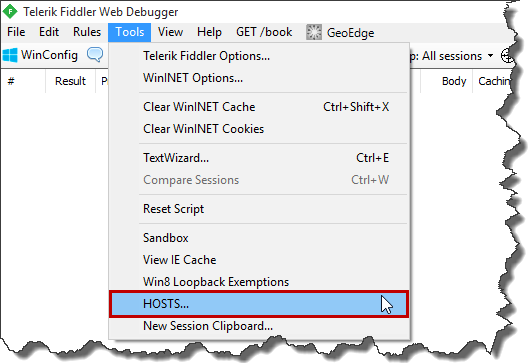

As a back-end developer I am quite often contacted by front-end devs to take a look why certain `UI` calls to the server results in wrong data being returned by `API`.
Usually I am provided with request payload so it is quite straightforward to reply it with `Postman` or `Fiddler` and see what is going on the backend.
However for time to time, replying single request is not enough to reproduce the problem.
In that case it is easier to just recreate the scenario on the `UI` and debug the `API` during that process.
Unfortunately this approach requires backend devs to have `UI` up and running on their local machines and that is not always possible (e.g. you might not get access to `UI` repository).
Fortunately with `Fiddler` it is quite easy to intercept outgoing front-end calls to the `API` and redirect them to your locally deployed version (so you can easily debug the `API`).

Let's assume we would like to redirect all `simpletestspa.azurewebsites.net` calls `to localhost:50277`. In order to do that run `Fiddler` and go to `Tools -> Hosts…`

[](http://tpodolak.com/blog/wp-content/uploads/2016/09/fiddler-redirecting-outgoing-calls-to-local-server/Toolsv2.png)

Select "`Enable remapping of requests for one host to a different host or IP, overriding DNS`" checkbox

[](http://tpodolak.com/blog/wp-content/uploads/2016/09/fiddler-redirecting-outgoing-calls-to-local-server/HostsWindow.png)

and enter following values in the editor

```text showLineNumbers=false
localhost:50277 simpletestspa.azurewebsites.net

```

From now every outgoing request to `simpletestspa.azurewebsites.net` will be redirected to your local instance of the server on `localhost:50277`.
