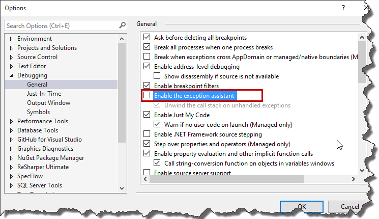

I think everyone is familiar with this nice exception window we see once exception is thrown.

However today for some reasons my `VisualStudio` started showing some weird dialog.

This was pretty frustrating as I wasn’t able to see which line has thrown exception and basically after clicking `Break` or `Continue` application was terminated. After a while I found out that the default window is called `Exception assistant` and you can enable it in `Visual Studio's` options. So in order to restore default behavior, just go to `Tools -> Options -> Debugging -> General` and select `Enable the exception assistant` checkbox.

