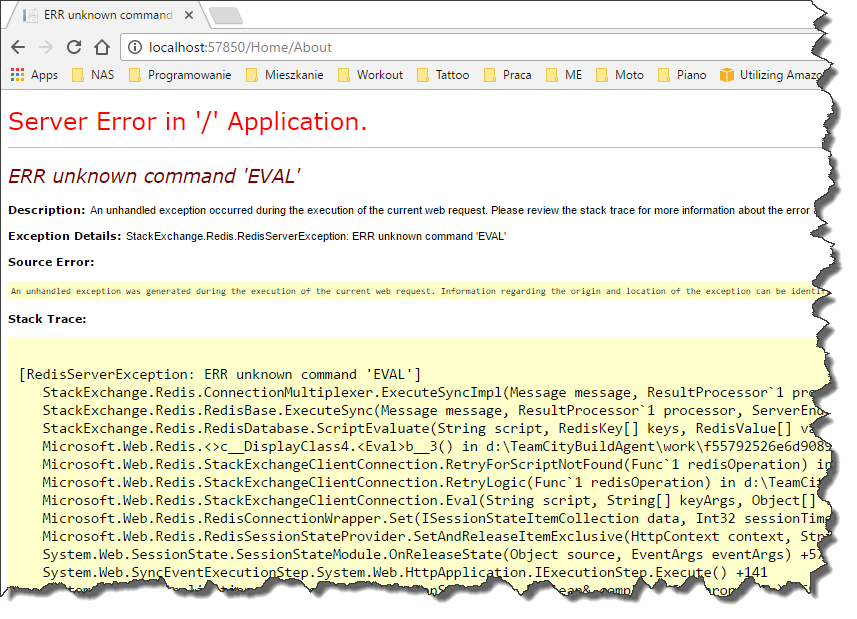
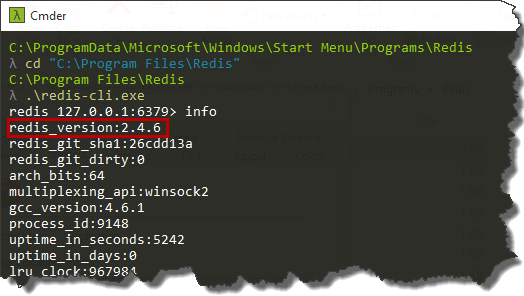
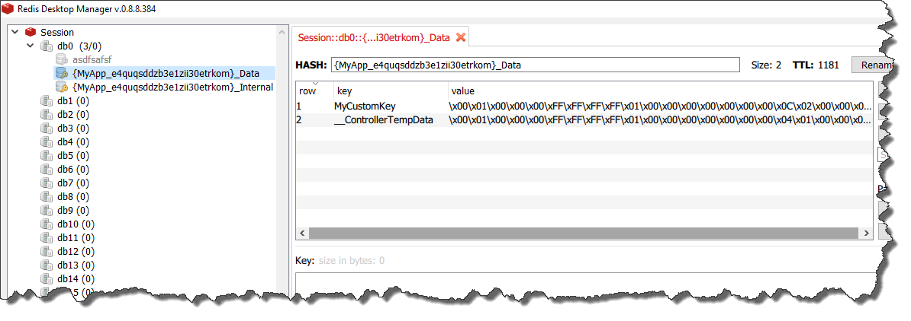

A couple of days ago I was trying to use `Redis` as session storage for one of my ASP .NET websites. Even though it seemed to be a rather straightforward task (Scott Hanselman wrote about that a [while ago](http://www.hanselman.com/blog/UsingRedisAsAServiceInAzureToSpeedUpASPNETApplications.aspx)), I ended up with some weird exception while running the app: `ERR unknown command 'EVAL'`

This wasn’t for sure a connectivity issue, as I was able to connect to `Redis` server from `Redis Client` - `redis-cli`. For me it looked like my server is not able to "understand" `EVAL` command. I started digging around and it turned out that this command has been introduced in version [2.6.0](http://redis.io/commands/EVAL) I've connected to the server using `redis-cli` and checked the version with
`info` command and basically that revealed the problem.

As you can see I've accidentally installed version 2.4.6 (I have no idea how I ended up with so old version). After upgrading to the newest one, my problem was gone and I was able to successfully store session in `Redis`. 

