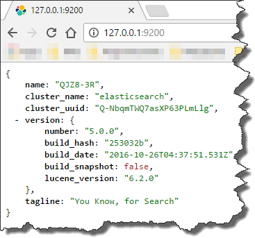
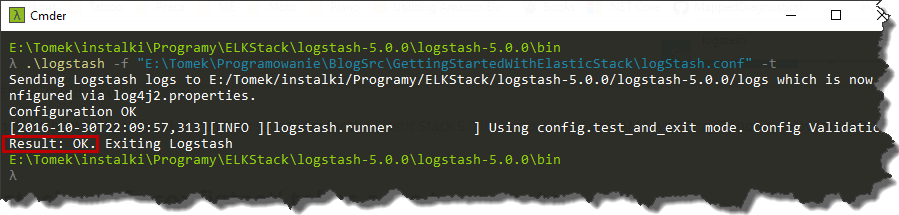
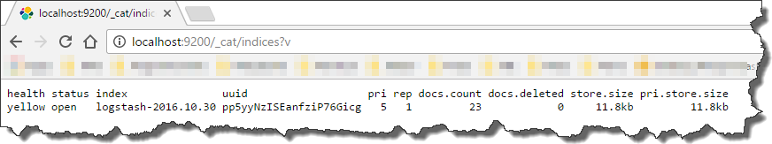
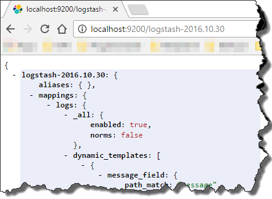
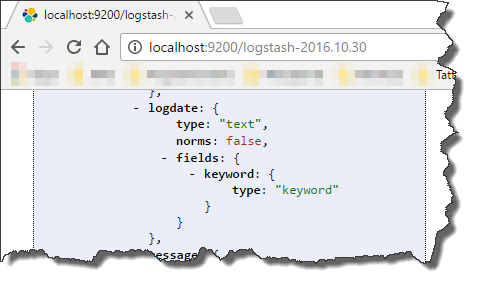
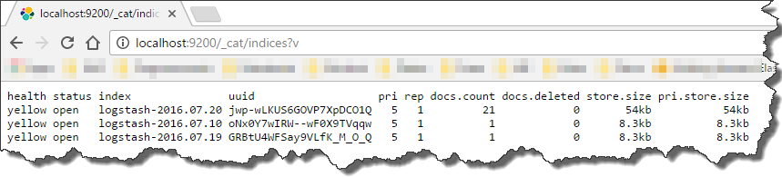
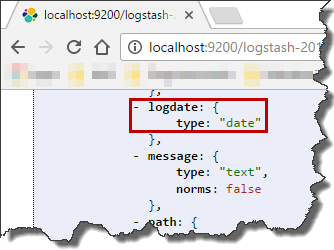
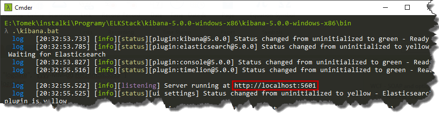
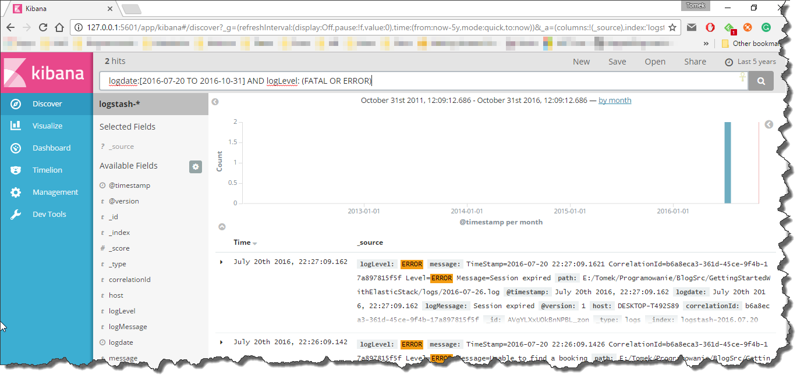

### 1\. Introduction

In one of my previous post I've shown how to improve logging in an application by tracking the flow of incoming requests. Now it is time to show the basics of `Elastic stack` to make searching across multiple log files/sources a piece of cake. `Elastic stack` (previously called `ELK stack`) is set of three tools which allows you to parse (`Logstash`), query (`Elasticsearch`) and visualize (`Kibana`) logs with ease.

### 2\. Installation

First of all (as usual) we have to get the tools, so go to [elastic.co](https://www.elastic.co/downloads) and download apps mentioned before. These are stand-alone applications so no installation is required. The only requirement is to have `JAVA\`HOME_ system variable pointing to your java directory. In my case, this looks as follows

```text showLineNumbers=false
C:\Program Files\Java\jre1.8.0_91\

```

### 3\. Elasticsearch

Once all three applications are downloaded we can run `Elasticsearch` (as there is not additional configuration needed for basic usage) instance via an `elasticsearch.bat` file.

[](http://tpodolak.com/blog/wp-content/uploads/2016/10/getting-started-elastic-stack/ElasticSearchWeb-1.png)

### 4\. Logstash

Having our `Elasticsearch` instance up and running, now it is time configure `Logstash` so that it will be able to parse logs. Configuration provided in next sections will be able to parse logs with the following format

```log wrap=false showLineNumbers=false
TimeStamp=2016-07-20 21:22:46.0079 CorrelationId=dc665fe7-9734-456a-92ba-3e1b522f5fd4 Level=INFO Message=About to start GET / request

```

#### 4.1. Configuration

`Logstash` configuration is done via config file in specific format. You can read about that [here](https://www.elastic.co/guide/en/logstash/current/configuration-file-structure.html) The very first step is to define input and output sections

```json
input {
    file {
        path => ["C:/logs/*.log"]
        start_position => beginning
    }
}
output {
    elasticsearch {
        hosts => "localhost:9200"
    }
    stdout {}
}

```

As you can see the logs will be read from `C:\logs` directory and parsed content will be pushed to `Elasticsearch` instance and to the console output. We can verify correctness of configuration calling

```bat showLineNumbers=false frame="none"
logstash.bat -f  "Path\To\Config\File.conf" -t

```

[](http://tpodolak.com/blog/wp-content/uploads/2016/10/getting-started-elastic-stack/ConfigurationTest.png)

If you are making your config file for the first time it is good idea to add additional properties to the `file` section

```json
ignore_older => 0
sincedb_path => "NUL"

```

This will force `Logstash` to reparse entire file when restarted and will also make sure that older files are not ignored (by default files modified more than 24 hours ago are ignored).

At this point, `Logstash` can read the log file but it doesn’t do anything special with it. Next step is to configure a pattern which will be used for log parsing. `Logstash` uses `grok` for defining the patterns. Long story short it is kind of a regex which can use predefined patterns. The easiest way to play around with it is to use [grokconstructor](http://grokconstructor.appspot.com/), for list of ready to use patterns take a look at [this](https://www.elastic.co/guide/en/logstash/current/plugins-filters-grok.html)

For parsing logs shown in previous section I've ended up with this grok pattern

```text showLineNumbers=false wrap=false
TimeStamp=%{TIMESTAMP_ISO8601:logdate} CorrelationId=%{UUID:correlationId} Level=%{LOGLEVEL:logLevel} Message=%{GREEDYDATA:logMessage}

```

Notice that you are able to give aliases for particular fields, for instance

```text showLineNumbers=false wrap=false
TimeStamp=%{TIMESTAMP_ISO8601:logdate} 

```

means that everything that matches `TimeStamp=%{TIMESTAMP\ISO8601}` will be stored in `logdate` field. Having defined our pattern, now we can add it to the config file. After modifications, it looks as follows

```json
input {
    file {
        path => ["C:/logs/*.log"]
        start_position => beginning
    }
}
filter {
    grok {
        match => { "message" => "TimeStamp=%{TIMESTAMP_ISO8601:logdate} CorrelationId=%{UUID:correlationId} Level=%{LOGLEVEL:logLevel} Message=%{GREEDYDATA:logMessage}" }
    }
}
output {
    elasticsearch {
        hosts => "localhost:9200"
    }
    stdout {}
}

```

Once we run this config and start querying elastic search for list of all indices via

```text showLineNumbers=false
http://localhost:9200/_cat/indices?v

```

we will see that our logs were parsed and stored in index called `logstash-2016.10.30` 

[](http://tpodolak.com/blog/wp-content/uploads/2016/10/getting-started-elastic-stack/indices.png)

If we now go to

```text showLineNumbers=false
http://localhost:9200/logstash-2016.10.30

```

we will be able to see index information

[](http://tpodolak.com/blog/wp-content/uploads/2016/10/getting-started-elastic-stack/IndexInfo-1.png)

#### 4.2. Fixing the date fields

At this moment there are two main problems with our configuration. First of all, the indices are created based on read time from file. Second of all our `logdate` field is treated as string.

[](http://tpodolak.com/blog/wp-content/uploads/2016/10/getting-started-elastic-stack/logdateasstring.png)

By default `Logstash` creates indices based on read time of the source. However in my opinion it is better to create index names based on time given event occurred. In order to do that, we have to tell the `Logstash` which field is responsible for holding timestamp. In my case, this field is called `logdate`. All we have to do is to map this field into field via date filter

```json
date {
        match => [ "logdate", "yyyy-MM-dd HH:mm:ss.SSSS" ]
}

```

As you can see first argument is a filed name and rest of the arguments (you can specify more) are just date time formats. By default date filter maps a field from the `match` property into `@timestamp` field. So the config above equals this one

```json
date {
        match => [ "logdate", "yyyy-MM-dd HH:mm:ss.SSSS" ]
        target => "@timestamp"
}

```

If we restart `Logstash` and get the indices, we will see something similar to that

[](http://tpodolak.com/blog/wp-content/uploads/2016/10/getting-started-elastic-stack/multipleindices.png)

Second problem can be handled in very similar way. We have to add second date filter and select as target `longdate` field

```json
date {
        match => [ "logdate", "yyyy-MM-dd HH:mm:ss.SSSS" ]
        target => "logdate"
}

```

From now on `logdate` field will be treated as date so we will be able to filter the logs easily with `Kibana`

[](http://tpodolak.com/blog/wp-content/uploads/2016/10/getting-started-elastic-stack/logdateasdate.png)

### 5\. Running Kibana

Having all the configuration in place now we are ready to run `Kibana`. As in previous steps, no installation is needed so just run the `Kibana.bat` file

[](http://tpodolak.com/blog/wp-content/uploads/2016/10/getting-started-elastic-stack/kibanastarted.png)

and go to

```text showLineNumbers=false
http://localhost:5601/

```

If you run the app for the first time you will be asked to configure the indices. You can use the default parameters and just click "Create" button. Once the indices are setup you can start writing queries against the logs. By default entire message is searched for the search terms, however the real power comes with queries written against specific fields. For example, you can search for any errors in the application with this simple query

```text showLineNumbers=false
logLevel: (FATAL OR ERROR)

```

Thanks to date type fields, you can combine this query with date range selector and narrow down time to specific values, just like that

```text showLineNumbers=false
logdate:[2016-07-20 TO 2016-10-31] AND logLevel: (FATAL OR ERROR)

```

[](http://tpodolak.com/blog/wp-content/uploads/2016/10/getting-started-elastic-stack/kibanasearchresults-1.png)

These are just the basic queries you can run in Kibana, for more advanced scenarios please visit [website](https://www.elastic.co/guide/en/elasticsearch/reference/5.0/query-dsl-query-string-query.html#query-string-syntax) . I also strongly encourage you guys to take a look at other feature `Elastic stack` provides. Source code for this post can be found [here](https://github.com/tpodolak/Blog/tree/master/GettingStartedWithElasticStack)

PS Configuration presented in this post will not be able to parse multiline log entries e.g. exceptions. I will show you how to do it in the next post.
