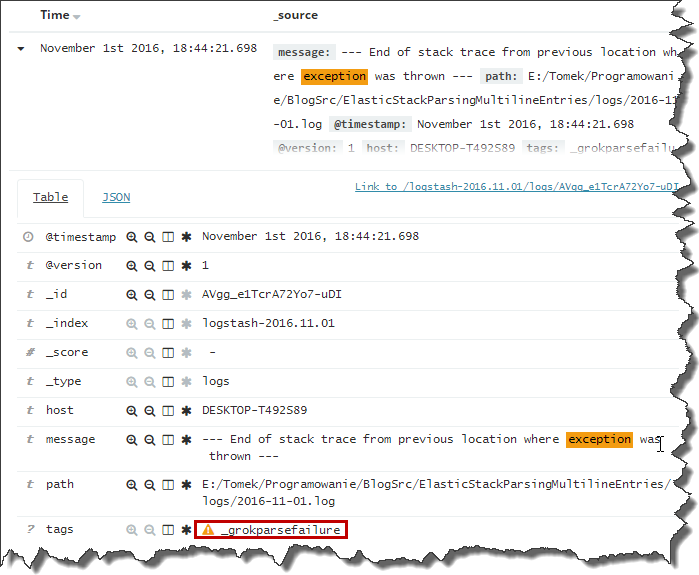
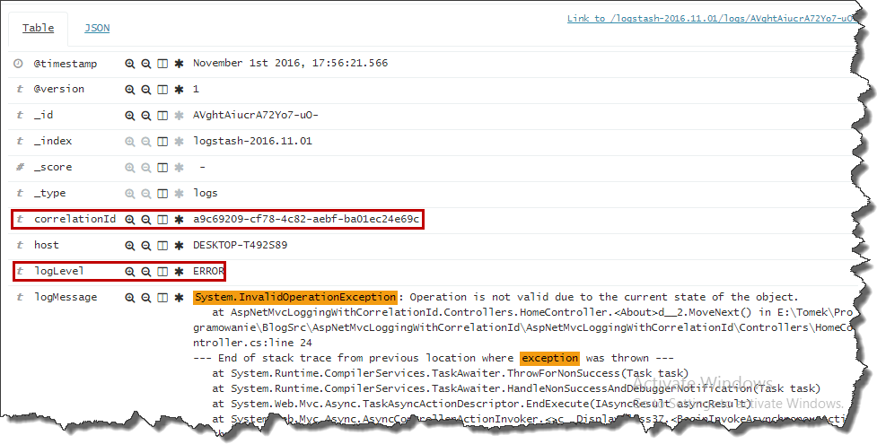

In my previous [post](http://tpodolak.com/blog/2016/11/02/getting-started-elastic-stack/) I've shown how to configure `Logstash` so that, it would be able to parse the logs in custom format.
Configuration presented in that post had one significant drawback - it wasn't able to parse multiline log entries.
This is a rather common scenario, especially when you log exceptions with a stack trace. Log entry, in that case may look as follows

```log wrap=false showLineNumbers=false
TimeStamp=2016-11-01 02:08:02.9086 CorrelationId=69dd69bb-3457-4440-8f77-88b1fd39255a Level=ERROR Message=System.InvalidOperationException: Operation is not valid due to the current state of the object.
   at AspNetMvcLoggingWithCorrelationId.Controllers.HomeController.<About>d__2.MoveNext() in E:\Tomek\Programowanie\BlogSrc\AspNetMvcLoggingWithCorrelationId\AspNetMvcLoggingWithCorrelationId\Controllers\HomeController.cs:line 24
--- End of stack trace from previous location where exception was thrown ---
   at System.Runtime.CompilerServices.TaskAwaiter.ThrowForNonSuccess(Task task)
   at System.Runtime.CompilerServices.TaskAwaiter.HandleNonSuccessAndDebuggerNotification(Task task)
   at System.Web.Mvc.Async.TaskAsyncActionDescriptor.EndExecute(IAsyncResult asyncResult)
   at System.Web.Mvc.Async.AsyncControllerActionInvoker.<>c__DisplayClass37.<BeginInvokeAsynchronousActionMethod>b__36(IAsyncResult asyncResult)
   at System.Web.Mvc.Async.AsyncResultWrapper.WrappedAsyncResult`1.CallEndDelegate(IAsyncResult asyncResult)
   at System.Web.Mvc.Async.AsyncResultWrapper.WrappedAsyncResultBase`1.End()
   at System.Web.Mvc.Async.AsyncControllerActionInvoker.EndInvokeActionMethod(IAsyncResult asyncResult)
   at System.Web.Mvc.Async.AsyncControllerActionInvoker.AsyncInvocationWithFilters.<InvokeActionMethodFilterAsynchronouslyRecursive>b__3d()
   at System.Web.Mvc.Async.AsyncControllerActionInvoker.AsyncInvocationWithFilters.<>c__DisplayClass46.<InvokeActionMethodFilterAsynchronouslyRecursive>b__3f()
   at System.Web.Mvc.Async.AsyncControllerActionInvoker.<>c__DisplayClass33.<BeginInvokeActionMethodWithFilters>b__32(IAsyncResult asyncResult)
   at System.Web.Mvc.Async.AsyncResultWrapper.WrappedAsyncResult`1.CallEndDelegate(IAsyncResult asyncResult)
   at System.Web.Mvc.Async.AsyncResultWrapper.WrappedAsyncResultBase`1.End()
   at System.Web.Mvc.Async.AsyncControllerActionInvoker.EndInvokeActionMethodWithFilters(IAsyncResult asyncResult)
   at System.Web.Mvc.Async.AsyncControllerActionInvoker.<>c__DisplayClass21.<>c__DisplayClass2b.<BeginInvokeAction>b__1c()
   at System.Web.Mvc.Async.AsyncControllerActionInvoker.<>c__DisplayClass21.<BeginInvokeAction>b__1e(IAsyncResult asyncResult)
```

Parsing these kind of messages using current configuration will result in grok parsing error

[](http://tpodolak.com/blog/wp-content/uploads/2016/11/elastic-stack-parsing-multiline-log-entries/GrokFailure.png)

and we won't be able to search against predefined fields.
Fortunately `Logstash` allows you to configure something called `input codecs` which basically allows you to transform input data into some other form.
One of those codes is `multiline codec`, which is responsible for "merging" multiline logs into one entry.
Here is example of codec configuration

```json
codec => multiline {
                       pattern => "^TimeStamp=%{TIMESTAMP_ISO8601}"
                       negate => true
                       what => "
}

```

The code above says that any line not starting with a `TimeStamp=timestamp value` should be merged with the previous line. Multiline coded can be added to a variety of inputs. Here is how you can apply it to `file` input

```json
input {
    file {
        path => ["E:/Tomek/Programowanie/BlogSrc/ElasticStackParsingMultilineEntries/logs/*.log"]
        start_position => beginning
        ignore_older => 0
        sincedb_path => "NUL"
        codec => multiline {
                               pattern => "^TimeStamp=%{TIMESTAMP_ISO8601}"
                               negate => true
                               what => "previous"
        }
    }
}

```

Thanks to that change, `Logstash` is now able to correctly parse exceptions from our logs.

[](http://tpodolak.com/blog/wp-content/uploads/2016/11/logstash-parsing-multiline-log-entries/Fixed2.png)


Source code for this post can be found [here](https://github.com/tpodolak/Blog/tree/master/ElasticStackParsingMultilineEntries)
