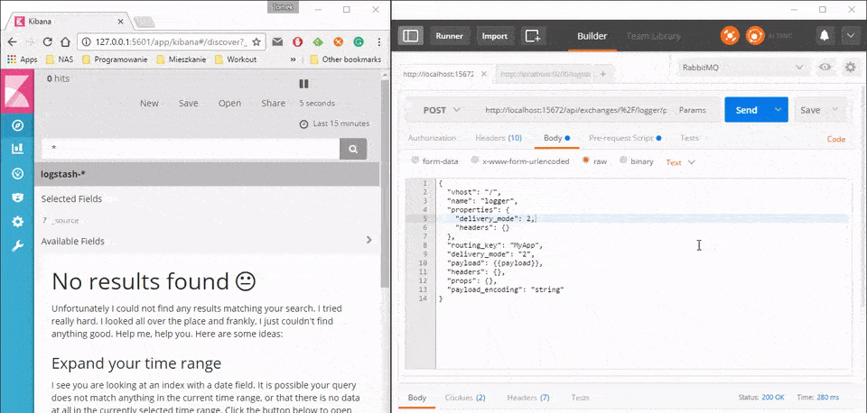

### 1\. Introduction

In my previous post, I've shown how to configure `Logstash` to parse logs from files. This is pretty useful however if your application is deployed on multiple servers, you usually log to some kind of central log storage - in my case to queue, `RabbitMQ` to be more specific.
In this post, I will show how to configure `Logstash` so it reads the logs from that queue.

### 2\. Preparing queue

Before we move to `Logstash` configuration, first of all, we have to prepare `RabbitMQ` test instance.
If you don't have `RabbitMQ` yet, go to [this](https://www.rabbitmq.com/download.html) website and install the queue.
Once installation is done, go to the installation folder (`C:\Program Files\RabbitMQ Server\rabbitmq\server-3.6.5\sbin` in my case) and run in console

```bash frame=none showLineNumbers=false
rabbitmq-plugins.bat enable rabbitmq_management

```

This command will prepare `RabbitMQ` management website, so it will be easier for us to see what is going on in given queue. In the next step, we have to prepare the queue, the logs will be sent to. You can do it via the website we've just enabled (`http://localhost:15672/`) or via `RabbitMQ` admin console. As I prefer to automate things as much as possible I will do it via command line. What is quite unusual when it comes `RabbitMQ CLI` is the fact that it is a python script you have to download and run locally (this is not an executable). The script can be found on management site under this [address](http://localhost:15672/cli/rabbitmqadmin). Once the script is downloaded (in my case it is saved as `rabbitmqadmin.py`) you can start preparing necessary elements: exchange, queue and the binding.

```bash frame=none
python rabbitmqadmin.py declare exchange name=logger type=topic -u username -p password

python rabbitmqadmin.py declare queue  name=MyAppLogginQueue auto_delete=false durable=true -u username -p password

python rabbitmqadmin.py  declare binding source=logger destination=MyAppLogginQueue routing_key=MyApp -u username -p password

```

As you can see I've created exchange called `logger` which is bound to `MyAppLogginQueue` queue using `MyApp` route. This means that every message with topic `MyApp` sent to `logger` exchange will be pushed to `MyAppLogginQueue` .

### 3\. Preparing Logstash

`Logstash` configuration will be modified version of my [previous](http://tpodolak.com/blog/2016/11/03/logstash-parsing-multiline-log-entries/) config. I will just add another input source. Here is a basic usage

```json
input {	
	rabbitmq {
        host => "localhost"
        queue => "MyAppLogginQueue"
        heartbeat => 30
        durable => true
        password => "password"
        user => "username"
    }
}

```

As you can see we will be consuming messages from `MyAppLogginQueue` which is deployed on `localhost`.
For `password` and `user` properties use your own credentials. That is basically it, so now it is time to see if everything is working.

### 4\. Testing coniguration

In order to test the configuration you have to run the `Elasticsearch`, `Kibana` and use new config for `Logstash`.
I've shown how to do it in one of my [recent post](http://tpodolak.com/blog/2016/11/02/getting-started-elastic-stack/).
For sending messages to the queue I will just use `RabbitMQ` management website `API`. The `API` exposes

```text
api/exchanges/%2F/{exchange_name}/publish

```

endpoint accepting `POST` verbs which can be used for publishing messages to given exchange. In my case `POST` body will look as follows

```json
{
  "vhost": "/",
  "name": "logger",
  "properties": {
    "delivery_mode": 2,
    "headers": {}
  },
  "routing_key": "MyApp",
  "delivery_mode": "2",
  "payload": "TimeStamp=2016-11-01 00:13:01.1669 CorrelationId=77530786-8e6b-45c2-bbc1-31837d911c14 Level=INFO Message=Request completed with status code: 200",
  "headers": {},
  "props": {},
  "payload_encoding": "string"
}

```

and I will be sending it to

```text showLineNumbers=false
http://localhost:15672/api/exchanges/%2F/logger/publish

```

Note that I will be sending messages to the exchange, not to the queue itself. The exchange's responsibility is to route the message to all bound queues. Here is how it looks in practice

[](http://tpodolak.com/blog/wp-content/uploads/2016/11/elastic-stack-reading-logs-queue/ezgif.com-gif-maker.gif) 

As you can see our configuration is valid and messages are shown on `Kibana's` dashboard almost in real time.

Full `Logstash` config can be found [here](https://github.com/tpodolak/Blog/tree/master/ElasticStackReadingFromRabbitMQ)
