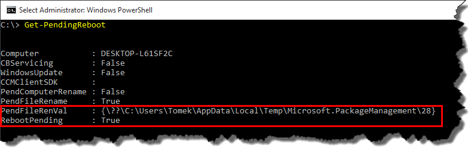
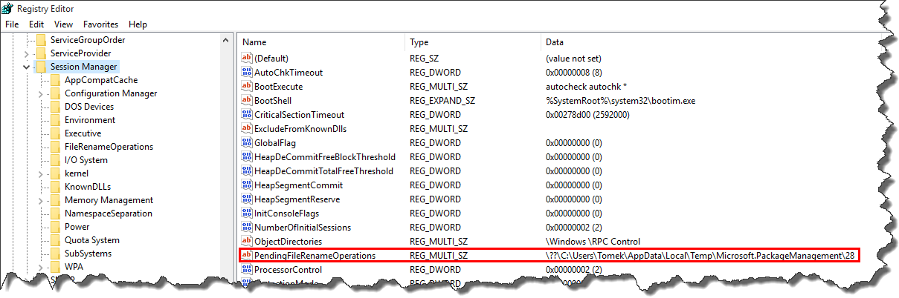
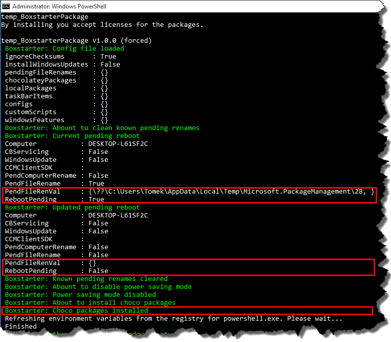
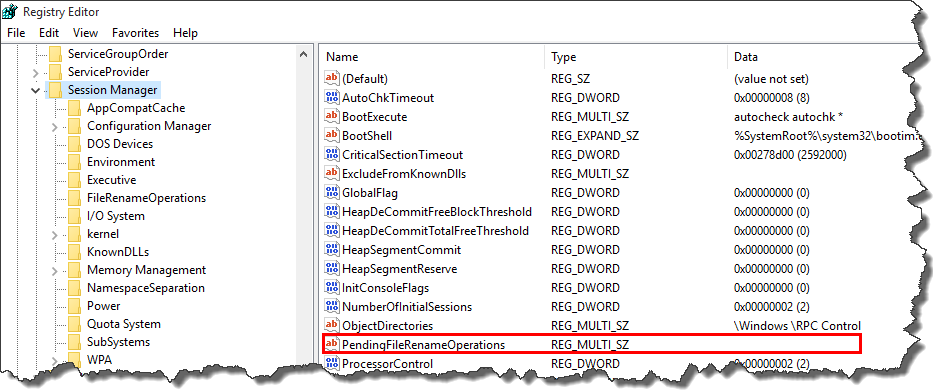

### 1\. Introduction

[Boxstarter](http://boxstarter.org/) is a great tool for configuring your machine without any user interaction. I've been using it for a while now, however recently I've noticed that for no apparent reason it wasn't able to finish the execution of provisioning script as it stuck in infinite reboot loop. Is was quite frustrating for me, that is why I've decided to investigate the problem. Here are my findings.

### 2\. Detecting pending reboots

If you dive into _Boxstarter_ source code you will notice that script responsible for checking if reboot is necessary uses [Get-PendingReboot](https://github.com/mwrock/boxstarter/blob/master/Boxstarter.Bootstrapper/Get-PendingReboot.ps1) cmdlet. By default _Boxstarter_ doesn’t export it, so if you want to see what it does you have to add following line in your _Boxstarer_ script

```powershell
Import-Module (Join-Path $Boxstarter.BaseDir Boxstarter.Bootstrapper\Get-PendingReboot.ps1) -global -DisableNameChecking

```

Calling the _Get-PendingReboot_ cmdlet will give you an information about mandatory reboots. In my case, the output looked as follows [](/tpodolak.com/blog/wp-content/uploads/2016/12/boxstarter-breaking-infinite-reboot-loop/GetPendingReboot.png) As you can see _RebootPending_ flag is set to true and the reason is that the value of _PendingFileRenVal_ property is not null. Basically, in most of the cases, a restart is indeed required however, some applications leave information about pending reboot in the registry (_HKEY\_LOCAL\_MACHINE\\SYSTEM\\CurrentControlSet\\Control\\Session Manager\\PendingFileRenameOperations_) and operating system (in some cases) never cleans this up. As a result _Get-PendingReboot_ indicates that reboot is required and _Boxstarter_ falls into infinite restart loop. [](//tpodolak.com/blog/wp-content/uploads/2016/12/boxstarter-breaking-infinite-reboot-loop/PendingFileRenameOperationsFrame.png)

### 3\. Fixing the problem

The obvious solution is to remove that value from the registry key manually. However this approach didn’t work for me, basically because the registry value somehow was added at the beginning of execution of my script. That is why, I've decided to modify my script and add a function which clears undesirable pending file renames of my choice.

```powershell
function Clear-Known-Pending-Renames($ignoredRenames){
    $regKey = "HKLM:SYSTEM\CurrentControlSet\Control\Session Manager\"
    $regProperty = "PendingFileRenameOperations"
    $pendingReboot = Get-PendingReboot

    Write-BoxstarterMessage "Current pending reboot $($pendingReboot | Out-String)"
    
    if($pendingReboot.PendFileRename){

        $output = $pendingReboot.PendFileRenVal | %{$_ -split [Environment]::NewLine} | ? { 
            $current = $_
            ![string]::IsNullOrWhiteSpace($current) -and ($ignoredRenames | ? { $current.StartsWith($_)  } ).Length -eq 0 } | Get-Unique

        if($output -eq $null){
            $output = @()
        }
        
        Set-ItemProperty -Path $regKey -Name $regProperty -Value ([string]::Join([Environment]::NewLine, $output))
        Write-BoxstarterMessage "Updated pending reboot $(Get-PendingReboot | Out-String)"
    }
}

```

As you can see I am taking current value of _PendingFileRenameOperations_ and remove the entries which I know that will stay there forever. Calling that function as the very first step of my installation script solved the problem and I was able to successfully restore my machine from _Boxstarter_ script [](//tpodolak.com/blog/wp-content/uploads/2016/12/boxstarter-breaking-infinite-reboot-loop/FullScrtipt.png)

[](//tpodolak.com/blog/wp-content/uploads/2016/12/boxstarter-breaking-infinite-reboot-loop/PendingFileRenameOperationsClearedFrame.png)

Entire Boxstarter script can be found [here](https://github.com/tpodolak/InstallBox).
