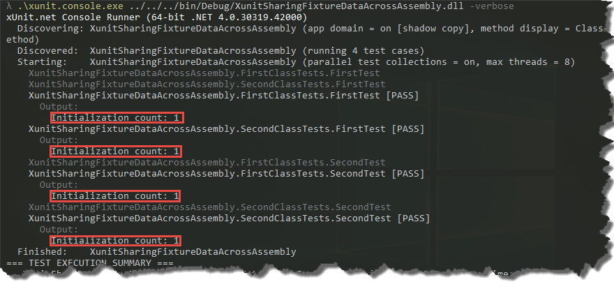

### 1\. Introduction

_XUnit_ provides two ways of sharing data between tests - _ICollectionFixture_ and _IClassFixture_. The first one allows you to shared context across collections and the second one across test classes. I've already had a couple of cases in which these fixtures were not enough. Basically, I wanted to share data between all tests in given assembly - without worrying in which test class or test collection given test is. In these circumstances, I've usually used some kind of old fashioned singleton or custom _TestFrameworkExecutor_. I've never liked those solutions, fortunately recently I've come across a nice little library - _xunit.assemblyfixture_.

### 2\. Usage

_Xunit.assemblyfixture_ allows you to share data between tests in given assembly via _IAssemblyFixture_ interface. The usage is basically the same as in other _XUnit's_ fixtures. All we have to do is to create a class which instance we want to share with other tests

```
public class TestFixture : IDisposable
{
    public static int InitializationCounter { get; private set; }

    public TestFixture()
    {
        InitializationCounter++;
    }

    public void Dispose()
    {
        // free resources if necessary
    }
}

```

And then create test classes which implement _IAssemblyFixture_ interface. If we want to have access to the fixture from the tests, we can inject instance of _TFixture_ via constructor

```
public class TestBase : IAssemblyFixture
{
    protected readonly ITestOutputHelper TestOutputHelper;
    protected readonly TestFixture Fixture;

    protected TestBase(ITestOutputHelper testOutputHelper, TestFixture fixture)
    {
        this.TestOutputHelper = testOutputHelper;
        this.Fixture = fixture;
    }

    protected void DisplayInitializationCount()
    {
        TestOutputHelper.WriteLine($"Initialization count: {TestFixture.InitializationCounter}");
    }
}

```

_Xunit.assemblyfixture_ fixture will ensure that given test class is shared via all the tests and is initialized only once. [](//tpodolak.com/blog/wp-content/uploads/2017/02/xunit-sharing-test-data-across-assembly/Shared.png) If you want to share multiple classes across the assembly, you can, of course, use _IAssemblyFixture_ multiple times.

### 3\. Visual Studio 2017 - XUnit beta tests runners

As for now _VS 2017 RC_ requires beta runners of _XUnit_ in order to run our unit tests. _xunit.assemblyfixture_ seems not to cooperate with them smoothly. However, there is a simple workaround to fix that. All we have to do is to add the following attribute to our test project

```
[assembly: TestFramework("Xunit.TestFramework", "xunit.assemblyfixture")]

```

And from now on, _XUnit_ correctly can inject assembly fixtures into our test classes

Source code for this post can be found [here](https://github.com/tpodolak/Blog/tree/master/XunitSharingFixtureDataAcrossAssembly)
