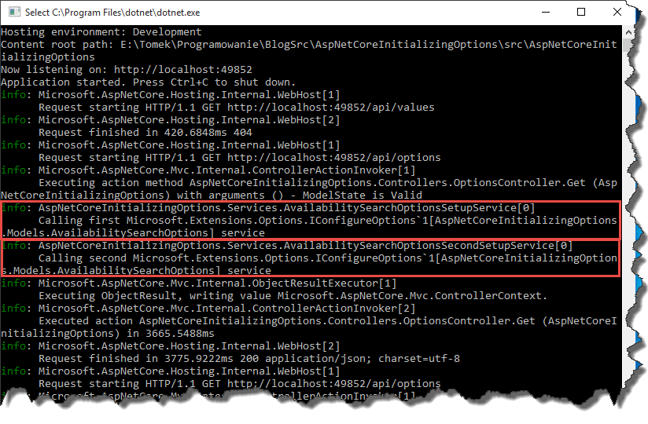

### 1\. Introduction

In `ASP.NET Core` `web.config` is no longer a proper place for storing application settings. New framework introduces the concept of a json based configuration and the default file which stores the settings now is `appsettings.json`. Here is a quick tutorial how to use new features.

### 2\. Reading configuration

Let's assume that our `appsettings.json` file looks as follows.

```json
{
    "Logging": {
        "IncludeScopes": false,
        "LogLevel": {
            "Default": "Debug",
            "System": "Information",
            "Microsoft": "Information"
        }
    },
    "AvailabilitySearchOptions": {
        "FlexDaysIn": 2,
        "FlexDaysOut": 3
    }
}

```

Thanks to `ConfigurationBuilder` we can parse this config and later on materialize sections or entire file into strongly typed configuration classes. Let's say we want to parse `AvailabilitySearchOptions` node to following class

```csharp
public class AvailabilitySearchOptions
{
    public int FlexDaysIn { get; set; }

    public int FlexDaysOut { get; set; }

    public TimeSpan MinimumConnectionTime { get; set; }

    public TimeSpan MinimumDepartureTime { get; set; }
}

```

We can achieve that with following steps. First of all, we need to read entire configuration

```csharp
public IConfigurationRoot Configuration { get; }

public Startup(IHostingEnvironment env)
{
    var builder = new ConfigurationBuilder()
                        .SetBasePath(env.ContentRootPath)
                        .AddJsonFile("appsettings.json", optional: true, reloadOnChange: true)
                        .AddJsonFile($"appsettings.{env.EnvironmentName}.json", optional: true)
                        .AddEnvironmentVariables();
    Configuration = builder.Build();
}

```

And in the next step we have to register `IOptions<AvailabilitySearchOptions>` in the container using `services.Configure<TOptions>(IConfiguration section)` method

```csharp
// This method gets called by the runtime. Use this method to add services to the container.
public void ConfigureServices(IServiceCollection services)
{
    // Add framework services.
    services.AddMvc();
    services.Configure(Configuration.GetSection("AvailabilitySearchOptions"));  
}

```

Note `Configuration.GetSection("AvailabilitySearchOptions")` passed as argument to `services.Configure` method. From now on we can access `AvailabilitySearchOptions` settings via `IOptions<AvailabilitySearchOptions>` interface, which you can easily inject into your classes.

```csharp
[Route("api/[controller]")]
public class OptionsController : Controller
{
    private readonly IOptions availabilitySearchOptions;

    public OptionsController(IOptions availabilitySearchOptions)
    {
        this.availabilitySearchOptions = availabilitySearchOptions;
    }

    public AvailabilitySearchOptions Get()
    {
        return availabilitySearchOptions.Value;
    }
}

```

### 3\. Populating `IOptions<T>` from external data source

From time to time, reading configuration just from `JSON` file might not be enough and for instance you would like to add additional configuration read from some external data source. Fortunately you don't have to resign from the `IOptions<T>` class as it is possible to read additional data for literally any other source thanks to `IConfigureOptions<T>` class. All we have to do is to create a setup class which implements `IConfigureOptions<T>` interface

```csharp
public class AvailabilitySearchOptionsSetupService : IConfigureOptions
{
    private readonly ILogger logger;
    private readonly IReservationSettingsService reservationSettingsService;
	
    public AvailabilitySearchOptionsSetupService(ILogger logger ,IReservationSettingsService reservationSettingsService)
    {
        this.logger = logger;
        this.reservationSettingsService = reservationSettingsService;
    }
	
    public void Configure(AvailabilitySearchOptions options)
    {
        this.logger.LogInformation($"Calling first {typeof(IConfigureOptions)} service");
        options.MinimumConnectionTime = reservationSettingsService.GetMinimumConnectionTime();
    }
}

```

And then registering this class in our container

```csharp
// This method gets called by the runtime. Use this method to add services to the container.
public void ConfigureServices(IServiceCollection services)
{
    // Add framework services.
    services.AddMvc();
    services.Configure(Configuration.GetSection("AvailabilitySearchOptions"));
    services.AddSingleton<IConfigureOptions<AvailabilitySearchOptions>, AvailabilitySearchOptionsSetupService>();
 }

```

From now on, when value of `IOptions<AvailabilitySearchOptions>` is accessed for very first time, `Configure` method from `AvailabilitySearchOptionsSetupService` will be called and you will be able to set additional values for your settings. Note that values from `appsettings.json` will already be there. In addition, it is possible to have multiple implementations of `IConfigureOptions<T>` so if you want your setup to be split into multiple classes you are good to go.

[](//tpodolak.com/blog/wp-content/uploads/2017/02/asp-net-core-populating-ioptions-external-data-source/multiple.png)

Source code for this post can be found [here](https://github.com/tpodolak/Blog/tree/master/AspNetCoreInitializingOptions)
