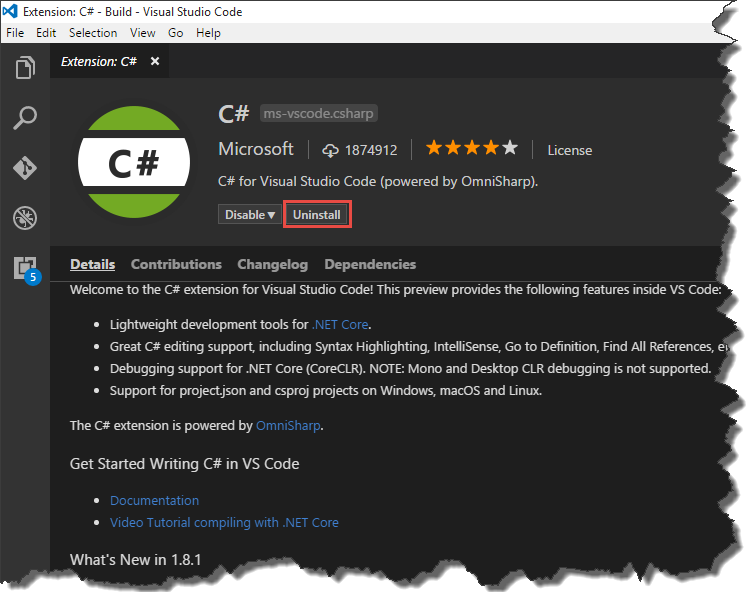
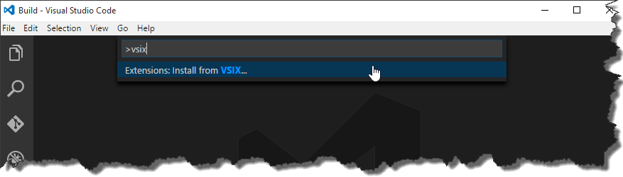
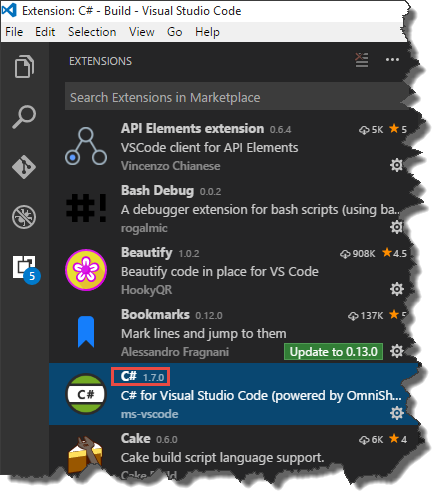

### 1\. Introduction

For time to time when you update Visual Studio Code's extension you realize that there were some breaking changes you don’t like or the extension has a bug which prevents you from using it. Usually, in this kind of situations, you would like to just go back to the version you were using previously rather than stop using the extension at all. Unfortunately, _VSCode_ doesn’t give us an option to install a specific version of the extension for [now](https://github.com/Microsoft/vscode/issues/12764). Luckily there is an easy way of doing that manually.

### 2\. Installation

Let's assume that I would like to downgrade _C#_ plugin from newest version (_1.8.1_ at the moment) to _1.7.0_. First of all, we have to uninstall current extension. As there as some issues of doing that via command line, just do it from _VSCode_ by clicking on uninstall button in extension screen. [](//tpodolak.com/blog/wp-content/uploads/2017/04/downgrading-visual-studio-code-extension/Initial.png) In the next step we have to download proper extension's version using _vsassets_ _api_. The url pattern looks as follows

```
https://${publisher}.gallery.vsassets.io/_apis/public/gallery/publisher/${publisher}/extension/${extension_name}/${version}/assetbyname/Microsoft.VisualStudio.Services.VSIXPackage

```

In my case, the variables looks as follow

- _${publisher}_ - ms-vscode
- _${extension\_name}_ - csharp
- _${version}_ - 1.7.0

and entire url can be rewritten as

```
https://ms-vscode.gallery.vsassets.io/_apis/public/gallery/publisher/ms-vscode/extension/csharp/1.7.0/assetbyname/Microsoft.VisualStudio.Services.VSIXPackage

```

Having the link prepared we can paste it into browser address bar and download the extension. Once the file is downloaded, run _VSCode_, hit _CTRL+SHIFT+P_, type _vsix_ in command line and choose

```
Extensions: Install from VSIX...

```

[](//tpodolak.com/blog/wp-content/uploads/2017/04/downgrading-visual-studio-code-extension/vsix.png) Select the file you've just downloaded and restart editor after installation. From now on you can use older version of your favorite extension. [](//tpodolak.com/blog/wp-content/uploads/2017/04/downgrading-visual-studio-code-extension/after.png)
