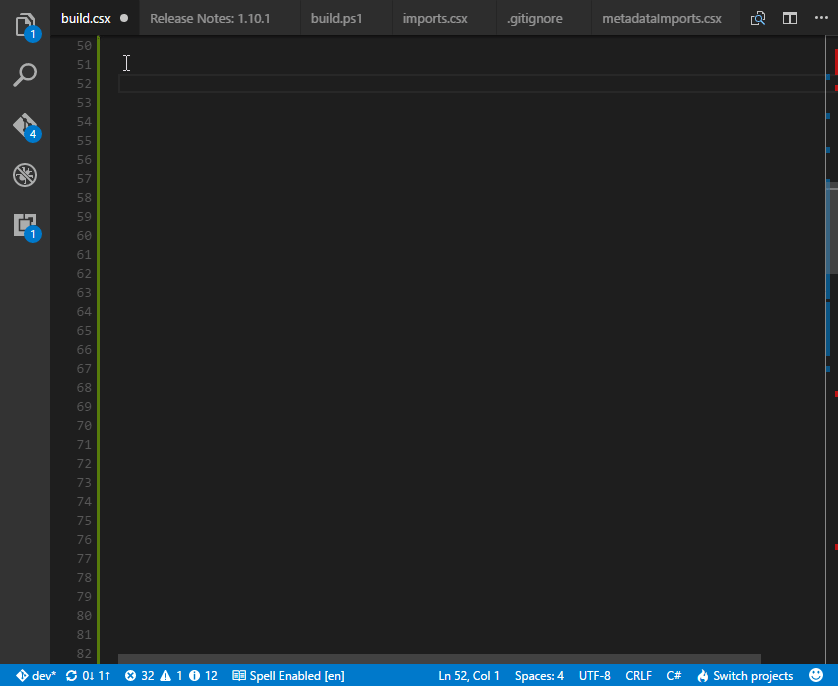

### 1\. Introduction

I've been using _Cake_ for quite some time now, and I really like this tool, however the more complex my build scripts are, the more painful lack of _IntelliSense_ is. Inspired a bit by this [post](http://www.strathweb.com/2016/12/writing-c-build-scripts-with-fake-omnisharp-and-vs-code/), I decided to see what it takes to enable at least partial _IntelliSense_ for _Cake_ scripts in Visual Studio Code.

### 2\. Investigation

The proper way of providing the code completion for _Cake_ scripts would probably be a plugin to _Omnisharp-Roslyn_, as _Cake_ script is basically a valid c# snippet. Unfortunately, at this moment _Omnisharp-Roslyn_ doesn’t have plugin infrastructure [ready](https://github.com/OmniSharp/omnisharp-roslyn/issues/208), that is why I decided to go with a bit different path. As you might or might not be aware, _VS Code_ already supports _csx_ files, so if you add an empty _project.json_ file (by empty I mean file with empty _JSON_ object) to your build directory and change extension of your scripts to _csx_, you will immediately get a _C#_ syntax highlighting and some _IntelliSense_ support. Sadly this will not provide code completion for _Cake_ method aliases. The reason why it fails on that is the fact that the _Cake_ alias is _ICakeContext_ extension method

```
[CakeMethodAlias]
public static T Argument(this ICakeContext context, string name)

```

but you use it as it was written as

```
[CakeMethodAlias]
public static T Argument(string name)

```

The _Cake_ engine generates additional alias overloads during script compilation, and as these overloads exist only on runtime, _VS Code_ just can't "see" them.

### 3\. My approach

Having in mind the way _Cake_ works I decided to write an application which would be able to take any _Cake_ or _Cake add-in_ and produce a library containing proper alias overloads. For instance, if original _Cake_ method looks as follows

/// /// Contains functionality related to arguments.
/// 
\[CakeAliasCategory("Arguments")\]
public static class ArgumentAliases
{
    /// /// Determines whether or not the specified argument exist.
    /// 
    /// The context.
    /// The argument name.
    /// Whether or not the specified argument exist.
    /// /// This sample shows how to call the method.
    /// `/// var argumentName = "myArgument";     /// //Cake.exe .\hasargument.cake -myArgument="is specified"     /// if (HasArgument(argumentName))     /// {     ///     Information("{0} is specified", argumentName);     /// }     /// //Cake.exe .\hasargument.cake     /// else     /// {     ///     Warning("{0} not specified", argumentName);     /// }     ///` 
    /// 
    \[CakeMethodAlias\]
    public static bool HasArgument(this ICakeContext context, string name)
    {
        // rest of the code omitted for brevity
    }
}

the application will rewrite it into

/// /// Contains functionality related to arguments.
/// 
\[CakeAliasCategory("Arguments")\]
public static class ArgumentAliasesMetadata
{
    /// /// Determines whether or not the specified argument exist.
    /// 
    /// The argument name.
    /// Whether or not the specified argument exist.
    /// /// This sample shows how to call the method.
    /// `/// var argumentName = "myArgument";     /// //Cake.exe .\hasargument.cake -myArgument="is specified"     /// if (HasArgument(argumentName))     /// {     ///     Information("{0} is specified", argumentName);     /// }     /// //Cake.exe .\hasargument.cake     /// else     /// {     ///     Warning("{0} not specified", argumentName);     /// }     ///` 
    /// 
    public static bool HasArgument(string name)
    {
        return default(bool);
    }
}

The algorithm looks more or less like that

- Retrieve Cake or Cake add-in via NuGet
- Scan an assembly and find all classes containing alias methods
- Use [CSharpCodeGenerationService](http://source.roslyn.io/#Microsoft.CodeAnalysis.CSharp.Workspaces/CodeGeneration/CSharpCodeGenerationService.cs,20912a440e5cda03) to generate metadata for Cake alias methods
- Parse generated code with _Roslyn_ and produce _SyntaxTree_
- Append Metadata suffix to classes containing alias method
- Remove _ICakeContext_ parameter from alias method
- Generate dummy body for methods which require that (methods which have return type or which have out parameters)
- Update xml documentation
- Compile generated code and produce dll

There is no point of doing more detailed description in here so if you want to take a closer look here is [source code](https://github.com/tpodolak/Cake.Intellisense).

### 4\. Generating metadata libraries

Before we start "hacking" _VS Code_ to have _IntelliSense_, we have to prepare metadata libraries which will contain all necessary _Cake_ alias overloads. In order to do that grab the application from [NuGet](https://www.nuget.org/packages/Cake.Intellisense/) and generate _Cake.Common_ and _Cake.Core_ metadata libraries. The simplest way of doing it is to run these commands

```
Cake.Intellisense.exe --Package Cake.Common --PackageVersion 0.19.2 --TargetFramework .NETFramework,Version=v4.5 --OutputFolder C:\Output
	
Cake.Intellisense.exe --Package Cake.Core --PackageVersion 0.19.2 --TargetFramework .NETFramework,Version=v4.5 --OutputFolder C:\Output

```

As a result, the application will produce following files:

- Cake.CommonMetadata.dll
- Cake.CommonMetadata.xml
- Cake.CoreMetadata.dll
- Cake.CoreMetadata.xml

### 5\. Enabling _IntelliSense_ in _VS Code_

Having our metadata libraries prepared now we can adjust our build scripts to have code completion in _VS Code_. Here are the steps:

- Add _project.json_ file with empty _JSON_ object into your build directory.
- Change extension of all your build scripts to _csx_.
- Copy metadata libraries into your _Build_ directory.
- Create _imports.csx_ file. This is the file which contains all original namespace imports. It may look as follows
    
    ```
    #load "./metadataImports.csx"
    using Cake.Core;
    using Cake.Core.IO;
    // rest of imports
    
    ```
    
- Create _metadataimports.csx_ file. This is the file which contains metadata namespaces imports and loads _Cake_ and metadata references.
    
    ```
    #r "./tools/Cake/Cake.Core.dll"
    #r "./tools/Cake/Cake.Common.dll"
    #r "./tools/Cake.Metadata/Cake.Core.Metadata.dll"
    #r "./tools/Cake.Metadata/Cake.Common.Metadata.dll"
    using static Cake.Common.ArgumentAliasesMetadata;
    using static Cake.Common.EnvironmentAliasesMetadata;
    // rest of imports
    
    ```
    
    Each original _Cake_ alias class has corresponding metadata class with Metadata suffix, for instance _Cake.Common.ArgumentAliases -> Cake.Common.ArgumentAliasesMetadata_ _Cake.Common.EnvironmentAliases -> Cake.Common.EnvironmentAliasesMetadata_
- Load _imports.csx_ to your _build.csx_ file via
    
    ```
    #load "./imports.csx"
    
    ```
    
- Run _VS Code_ install _[ms-vscode.csharp 1.7.0](//tpodolak.com/blog/2017/04/09/downgrading-visual-studio-code-extension/)_, open _Build_ directory and write your build script with _IntelliSense_ support [](http://imgur.com/ButIXBW)
- Before running the script remember to comment out
    
    ```
    #load "./metadataImports.csx"
    
    ```
    
    from _imports.csx_ file
- Run the build
    
    ```
    build.ps1 -script build.csx -target Your-Target
    
    ```
    

I do realize this is quite convoluted explanation so in case of any troubles take a look at my [build](https://github.com/tpodolak/Cake.Intellisense/tree/master/Build)

### 6\. Known issues

- _Cake.Intellisense_ can only generate metadata libraries for a standard .NET frameworks, it will fail if you try to create metadata targeting _.NETStandard_ or _.NET Core_ framework
- Due to some [breaking changes](https://github.com/OmniSharp/omnisharp-roslyn/issues/811) in _Omnisharp-Roslyn_ scripting support, _IntelliSense_ will only work with _Omnisharp 1.7.0_

### 7\. Summary

This approach is just a temporary solution. As you can see, it requires significant amount of work to have a code completion in _VS Code_. I believe that once _Omnisharp-Roslyn_ has proper plugin support it should be possible to write some kind of custom _IntelliSense_ provider for _Cake_ scripts. There are already people who forked _Omnisharp-Roslyn_ and play around with [that](https://github.com/mholo65/omnisharp-roslyn/tree/wip/new-cake-plugin), so we just have to wait for something better than this solution.
