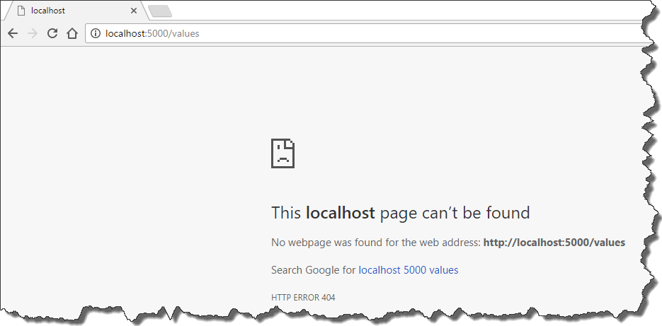
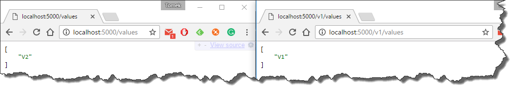

### 1\. Introduction.

When you start versioning your `API` sometimes you want to have access to your endpoints without specifying version explicitly.
Thanks to [Microsoft.AspNetCore.Mvc.Versioning](https://www.nuget.org/packages/Microsoft.AspNetCore.Mvc.Versioning) library this can be easily achieved with proper setup of configuration action.
However, it turns out that in order to enable default `API` version for url path versioning, there are a couple additional steps to do.

### 2\. Default `API` version without url path versioning

Let's start with the initial setup of `API` versioning which will work for every type of versioning apart from url path versioning.
All you have to do is to assign an `ApiVersionSelector` and set the `AssumeDefaultVersionWhenUnspecified` property to true.

```csharp
public void ConfigureServices(IServiceCollection services)
{
    // Add framework services.
    services.AddApiVersioning(options =>
    {
        options.ApiVersionReader = new QueryStringApiVersionReader();
        options.AssumeDefaultVersionWhenUnspecified = true;
        options.ApiVersionSelector = new CurrentImplementationApiVersionSelector(options);
    });
}
```

Now when the user will try to access the endpoint without specifying version explicitly the `ApiVersionSelector` will select proper version - in this case highest available version.

### 3\. Default Api version with URL path versioning

Running the same configuration against controllers which are versioned via url path (not query string)

```csharp
namespace AspNetCoreDefaultApiVersionAndRoutePrefix.Controllers.V1
{
    [Route("v{version:apiVersion}/[controller]")]
    [ApiVersion("1")]
    public class ValuesController : Controller
    {
        // GET api/values
        [HttpGet]
        public IEnumerable<string> Get()
        {
            return new string[] {"V1"};
        }
    }
}

namespace AspNetCoreDefaultApiVersionAndRoutePrefix.Controllers.V2
{
    [Route("v{version:apiVersion}/[controller]")]
    [ApiVersion("2")]
    public class ValuesController : Controller
    {
        // GET api/values
        [HttpGet]
        public IEnumerable<string> Get()
        {
            return new string[] {"V2"};
        }
    }
}
```

will result with `404` status code, as routing is not able to match the url.

[](//tpodolak.com/blog/wp-content/uploads/2017/05/asp-net-core-default-api-version-with-url-path-versioning/404.png)

Fortunately, unlike the `ASP.NET Web API`, `ASP.NET Core` allows us to have multiple route attributes applied to given controller, so in order to fix the issue we just have to add

```csharp
[Route("[controller]")]
```

attribute to versioned controllers. From now on we can access our `API` without specifying version as well as with version specified.

[](//tpodolak.com/blog/wp-content/uploads/2017/05/asp-net-core-default-api-version-with-url-path-versioning/after.png)

### 4\. Adding default route with convention

If you don’t want to specify default route manually for every controller, you can do it via application model convention.
The interesting thing about it is the fact that apart from changing existing values of application model we can also add new items to it.
This means that we can add additional `SelectorModel` with our default route to `Selectors'` collection

```csharp
public class DefaultRoutePrefixConvention : IApplicationModelConvention
{
    public void Apply(ApplicationModel application)
    {
        foreach (var applicationController in application.Controllers)
        {
            applicationController.Selectors.Add(new SelectorModel
            {
                AttributeRouteModel = new AttributeRouteModel
                {
                    Template = "[controller]"
                }
            });
        }
    }
}
```

Now we can get rid of `[Route("[controller]")]` attribute from our versioned controllers and just rely on convention which can be added as follows

```csharp
public void ConfigureServices(IServiceCollection services)
{
    // rest of the code omitted for brevity 
    services.AddMvc(mvc =>
    {
        mvc.Conventions.Add(new DefaultRoutePrefixConvention());
    });
}
```

Source code for this post can be found [here](https://github.com/tpodolak/Blog/tree/master/AspNetCoreDefaultApiVersionWithUrlPathVersioning)
