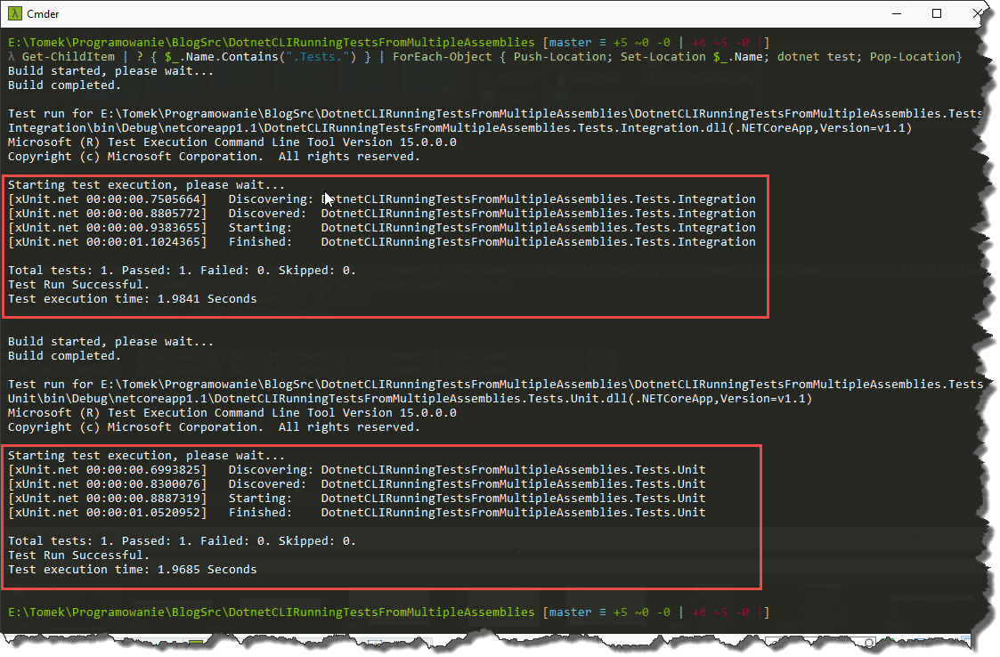
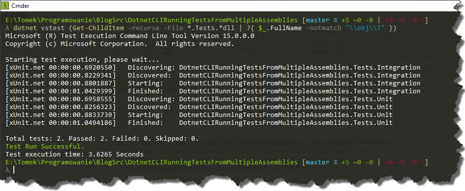

When you start looking for information how to run unit tests for `.NET Core` based projects in the command line, you will most probably stumble upon `dotnet CLI` and its [dotnet test](https://docs.microsoft.com/en-us/dotnet/core/tools/dotnet-test) command. The command works really great when you have just one test project in your solution, however, it doesn’t allow you to run tests from multiple projects at once. Of course, you can write little `PowerShell` which will run the command in the loop e.g.

```powershell frame="none"
Get-ChildItem | ? { $`.Name.Contains(".Tests.") } | ForEach-Object { Push-Location; Set-Location $`.Name; dotnet test; Pop-Location}

```

Unfortunately, in this case, you won't get an aggregated summary of tests results, instead, you will get a summary per test project.

[](//tpodolak.com/blog/wp-content/uploads/2017/06/dotnet-cli-running-tests-from-multiple-assemblies/dotnettest.png)

Luckily `dotnet CLI` have another command for running tests - namely [dotnet vstest](https://docs.microsoft.com/en-us/dotnet/core/tools/dotnet-vstest). In this case, we do not operate on projects but we provide a location for assemblies with tests. So if you, for instance, would like to run unit and integration tests at once, you can write something like that

```bash frame="none"
dotnet vstest .\DotnetCLIRunningTestsFromMultipleAssemblies.Tests.Integration\bin\Debug\netcoreapp1.1\DotnetCLIRunningTestsFromMultipleAssemblies.Tests.Integration.dll .\DotnetCLIRunningTestsFromMultipleAssemblies.Tests.Unit\bin\Debug\netcoreapp1.1\DotnetCLIRunningTestsFromMultipleAssemblies.Tests.Unit.dll

```

If you want a bit more flexible solution this simple `PowerShell` script will scan files and based on naming convention retrieve tests assemblies.

```bash frame="none"
dotnet vstest (Get-ChildItem -recurse -File *.Tests.*dll | ? { $_.FullName -notmatch "\\obj\\?" })

```

One way or another, the `dotnet vstest` command will aggregate all of the test results and will present them as one summary. 

[](//tpodolak.com/blog/wp-content/uploads/2017/06/dotnet-cli-running-tests-from-multiple-assemblies/dotnetvstest.png)

One thing to note, `dotnet vstest` won't build the solution, you have to run the build manually with `dotnet build` command. 

Source code for this post can be found [here](https://github.com/tpodolak/Blog/tree/master/DotnetCLIRunningTestsFromMultipleAssemblies)
