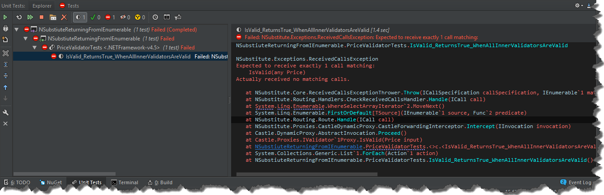
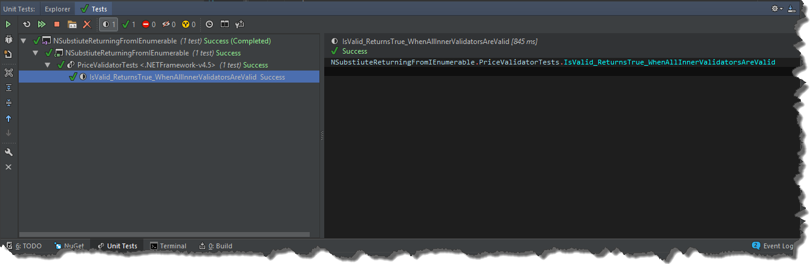

I've been using _NSubstitute_ combined with automocks for quite some time already, but recently I've encountered quite interesting situation. Let's assume that we have the following class we need to write tests for

```csharp
public class PriceValidator : IValidator
{
    private readonly IEnumerable> _innerValidators;

    public PriceValidator(IEnumerable> innerValidators)
    {
         _innerValidators = innerValidators;
    }

    public bool IsValid(Price input)
    {
        return _innerValidators.Any() && _innerValidators.All(validator => validator.IsValid(input));
    }
}

```

As mentioned before I wanted to test that class leveraging the concept of automocks. If you have never used them before, no worries, the idea is pretty simple. Instead of providing mock dependencies manually, you just generate them automatically. Once the dependencies are mocked you can retrieve and set them up if necessary. So in my case, I have to setup _IEnumerable<IValidator<Price>>_ mock so that it yields some values. It can be achieved by mocking return values of _GetEnumerator()_ method.

```javascript
var automock = new NSubstituteAutoMocker();
var innerValidators = new List>
{
    Substitute.For>(),
};            
automock.Get>>().GetEnumerator().Returns(innerValidators.GetEnumerator());

```

The entire test then can be written as

```csharp
[Fact]
public void IsValid_ReturnsTrue_WhenAllInnerValidatorsAreValid()
{
    var automock = new NSubstituteAutoMocker();
    var innerValidators = new List>
    {
        Substitute.For>(),
    };
    innerValidators.ForEach(validator => validator.IsValid(Arg.Any()).Returns(true));
    automock.Get>>().GetEnumerator().Returns(innerValidators.GetEnumerator());
            
    var result = automock.ClassUnderTest.IsValid(new Price());

    innerValidators.ForEach(validator => validator.Received(1).IsValid(Arg.Any()));
    result.Should().BeTrue();
}

```

Everything looks good at that point, however if you run the tests, it will fail [](//tpodolak.com/blog/wp-content/uploads/2017/06/nsubstitute-returning-from-ienumerable/FailedTest.png) That was quite surprising for me and I have to admit that at the beginning I thought it was a bug in _NSubstitute_. However, if you looks closely at the implementation of the test, you will see that every time validator collection is enumerated, the same instance of the enumerator is used. As the enumerator keeps its state, the first enumeration (_\_innerValidators.Any()_) will move a current element to the first position (which is the last position at the same time) so when I try to enumerate again (_\_innerValidators.All(validator => validator.IsValid(input)_) enumeration will continue from the previous position and the iteration will end yielding no results. Fortunately, with _NSubstitute_ you can configure the call so that it always returns a new value. The relevant code changes are shown below

```csharp
automock.Get>>().GetEnumerator().Returns(callInfo => innerValidators.GetEnumerator());

```

Running the tests again will give us "green" result [](//tpodolak.com/blog/wp-content/uploads/2017/06/nsubstitute-returning-from-ienumerable/Green.png)

Source code for this post can be found [here](https://github.com/tpodolak/Blog/tree/master/NSubstiuteReturningFromIEnumerable)
