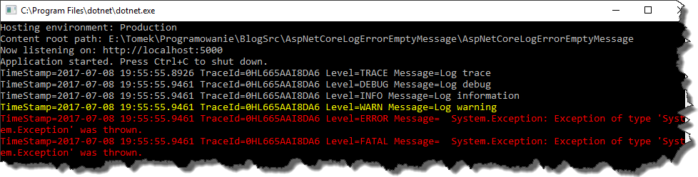

I've been using `NLog` for quite some time already, and it was a natural choice to use it in the `ASP.NET Core` projects as well.
I've configured the logger using [this](https://github.com/NLog/NLog.Web/wiki/Getting-started-with-ASP.NET-Core-\(csproj---vs2017\)) tutorial and everything seemed to be working fine.
Unfortunately, after some time we've noticed that for some reasons some of the errors are not logged.
We've taken a deeper look at our code base and we've found couple logs being written as follows

```csharp
_logger.LogError(exception.HResult, exception, string.Empty); 
_logger.LogCritical(exception.HResult, exception, string.Empty);
```

This piece of code works perfectly fine with `ASP.NET Core` console logger but it seems it doesn’t for `NLog`.
We double checked that with following piece of code

```csharp
[Route("api/[controller]")]
public class ValuesController : Controller
{
    private readonly ILogger<ValuesController> _logger;
        
    public ValuesController(ILogger<ValuesController> logger)
    {
        _logger = logger;
    }

    // GET api/values
    [HttpGet]
    public IEnumerable<string> Get()
    {
        var exception = new Exception();
        _logger.LogTrace("Log trace");
        _logger.LogDebug("Log debug");
        _logger.LogInformation("Log information");
        _logger.LogWarning("Log warning");
        _logger.LogError(exception.HResult, exception, string.Empty); // this one will not be logged
        _logger.LogCritical(exception.HResult, exception, string.Empty); // this one will not be logged as well            

        return new string[] {"value1", "value2"};
    }
}
```

And as you can see in the picture below, no errors have been reported

[](//tpodolak.com/blog/wp-content/uploads/2017/07/auto-draft/NoErrorsLogged.png)

Changing the error message to any message (even the one containing only white spaces)

```csharp
 _logger.LogError(exception.HResult, exception, " "); 
 _logger.LogCritical(exception.HResult, exception, " " ); 
```

fixed the problem.

[](//tpodolak.com/blog/wp-content/uploads/2017/07/auto-draft/ErrorsLoggedWithMessage.png)

That looks like a bug for me, so I will create a PR with the fix and see if that will make its way to the `master`

As usual, the source code for this post can be found on my [GitHub](https://github.com/tpodolak/Blog/tree/master/NLogWebAspNetCoreExceptionLoggingWithoutMessage)
