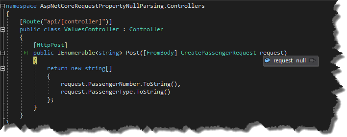
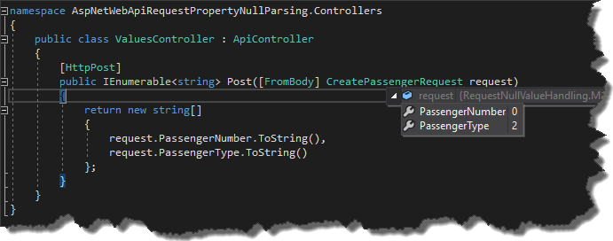
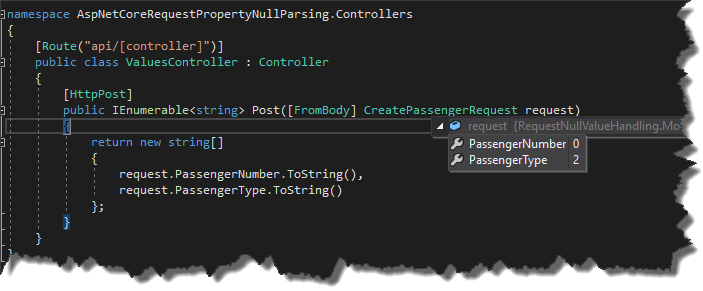

We've been migrating a classic `WebApi` application into the `ASP.NET Core API` for quite a while now, and last week we decided to deploy it on the test environment and try to run a website against it.
We were pretty confident about the quality of a migration because all of the integration tests from old `API` were green when running against a new one.
We were expecting maybe some business logic bugs but from our perspective, the infrastructure part was good to go.
Unfortunately, when the `QA's` run the selenium test suite they quickly found a major issue in our codebase.
They basically were getting `HTTP 500` errors indicating a `NullReferenceException`.
That was pretty surprising to us and after a bit of a digging we found following lines in the logs

```log wrap=false showLineNumbers=false
TimeStamp=2017-08-20 00:43:49.4383 TraceId=0HL77AF0N305P Level=DEBUG Message=JSON input formatter threw an exception. Newtonsoft.Json.JsonSerializationException: Error converting value {null} to type 'System.Int32'. Path 'PassengerNumber', line 2, position 26. ---> System.InvalidCastException: Null object cannot be converted to a value type.
   at System.Convert.ChangeType(Object value, Type conversionType, IFormatProvider provider)
   at Newtonsoft.Json.Serialization.JsonSerializerInternalReader.EnsureType(JsonReader reader, Object value, CultureInfo culture, JsonContract contract, Type targetType)
   --- End of inner exception stack trace ---
   at Newtonsoft.Json.Serialization.JsonSerializerInternalReader.EnsureType(JsonReader reader, Object value, CultureInfo culture, JsonContract contract, Type targetType)
   at Newtonsoft.Json.Serialization.JsonSerializerInternalReader.CreateValueInternal(JsonReader reader, Type objectType, JsonContract contract, JsonProperty member, JsonContainerContract containerContract, JsonProperty containerMember, Object existingValue)
   at Newtonsoft.Json.Serialization.JsonSerializerInternalReader.SetPropertyValue(JsonProperty property, JsonConverter propertyConverter, JsonContainerContract containerContract, JsonProperty containerProperty, JsonReader reader, Object target)
   at Newtonsoft.Json.Serialization.JsonSerializerInternalReader.PopulateObject(Object newObject, JsonReader reader, JsonObjectContract contract, JsonProperty member, String id)

```

this was resulting in a null request in controller's application

[](//tpodolak.com/blog/wp-content/uploads/2017/08/asp-net-core-request-serialization-issues-after-migration-from-classic-webapi/NullRequest.png)

As you can see `JSON` serializer was not able to convert null into the int.
We double checked the requests coming from front-end and this is how one of them looked like

```json
{
   "PassengerNumber": null,
   "PassengerType": "2"
}
```

whereas corresponding request class on the server side was written in following way

```csharp
public class CreatePassengerRequest
{
    public int PassengerNumber { get; set; }
        
    public int PassengerType { get; set; }
}
```

Clearly front-end shouldn't be sending a null as a `PassengerNumber` however the same request was serialized just fine when running against classic `WebApi`

[](//tpodolak.com/blog/wp-content/uploads/2017/08/asp-net-core-request-serialization-issues-after-migration-from-classic-webapi/NotNullAspWebApi.png)

Fortunately the fix for that was pretty straightforward. All we had to do was to configure `JSON` serializer to ignore null values.

```csharp
// This method gets called by the runtime. Use this method to add services to the container.
public void ConfigureServices(IServiceCollection services)
{
    services.AddMvc().AddJsonOptions(options =>
    {
        options.SerializerSettings.NullValueHandling = NullValueHandling.Ignore;
    });
}
```

From now on we were able to properly serialize the request

[](//tpodolak.com/blog/wp-content/uploads/2017/08/asp-net-core-request-serialization-issues-after-migration-from-classic-webapi/NotNullAfterChange.png)

Source code for this post can be found [here](https://github.com/tpodolak/Blog/tree/master/AspNetCoreRequestPropertyNullParsing)
