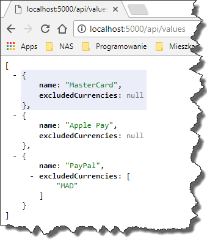
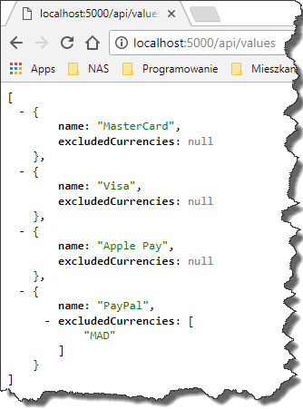

### 1\. Introduction

Last week while I was working on one of the features for my current project, I noticed quite surprising behavior of `IOptions<T>` object.
Long story short, for some reasons there were missing array elements in my parsed application settings class.

### 2\. Problem

Just like everyone else, we store our application settings in `JSON` file.
The settings are pretty straightforward, just a bunch of properties with some nested objects

```json
{
    "PaymentMethods": [
        {
            "Name": "MasterCard",
            "ExcludedCurrencies": []
        },
        {
            "Name": "Visa",
            "ExcludedCurrencies": null
        },
        {
            "Name": "Apple Pay"
        },
        {
            "Name": "PayPal",
            "ExcludedCurrencies": [
                "MAD"
            ]
        }
    ]
}
```

which are bound to the `AppSetting` class thanks to these couple of lines of code

```csharp
// This method gets called by the runtime. Use this method to add services to the container.
public void ConfigureServices(IServiceCollection services)
{            
    services.Configure<AppSettings>(Configuration);
    // Add framework services.
    services.AddMvc();
}
```

where `AppSettings` class looks as follows

```csharp
public class AppSettings
{
    public List<PaymentMethod> PaymentMethods { get; set; }
}

public class PaymentMethod
{
    public string Name { get; set; }

    public List<string> ExcludedCurrencies { get; set; }
}
```

As you can see nothing too fancy in here, standard `ASP.NET Core` approach for handling configuration files.
However, if you access the `PaymentMethods` property of `IOptions<AppSettings>`

```csharp
[Route("api/[controller]")]
public class ValuesController : Controller
{
    private readonly IOptions<AppSettings> _appSettings;

    public ValuesController(IOptions<AppSettings> appSettings)
    {
        _appSettings = appSettings;
    }
        
    // GET api/values
    [HttpGet]
    public List<PaymentMethod> Get()
    {
        return _appSettings.Value.PaymentMethods;
    }
}
```

you will see that instead of four elements we ended up having 3 items

[](//tpodolak.com/blog/wp-content/uploads/2017/10/asp-net-core-1-x-curios-case-of-missing-ioptions-array-item/MissingItem.png)

as the `Visa` element is missing.

### 3\. Solution

If you look closely at the `appsettings.json` file you will notice that a `Visa` item configuration is a bit different than the ones which are parsed just fine.
Namely `null` is assigned to `excludedCurrencies` property, whereas in other items an empty array or no property at all is used.
So the first fix is just to use the same approach as in the other items

```json
{
    "Name": "Visa",
    "ExcludedCurrencies": []
}
```

This approach works fine, however, it is not a silver bullet as someone still might use null and introduce a bug. 
Another fix might be upgrading to `ASP.NET Core 2.0` as the problem doesn’t seem to exist in there.
Of course, this is rather a huge change so not everyone will be willing to do it.
The last option is a manual installation of `Microsoft.Extensions.Configuration.Binder 2.0` along with `Microsoft.Extensions.Configuration.Json 2.0` package.
However, this approach requires you to retarget your application to `netcoreapp2.0`.
One way or another every solution in here works fine, so once you apply the fix you will see all items in the array

[](//tpodolak.com/blog/wp-content/uploads/2017/10/asp-net-core-1-x-curios-case-of-missing-ioptions-array-item/AllItems.png)

Source code for this post can be found [here](https://github.com/tpodolak/Blog/tree/master/ASP.NETCoreCuriousCaseOfMissingIOptionsOfTArrayItem)
