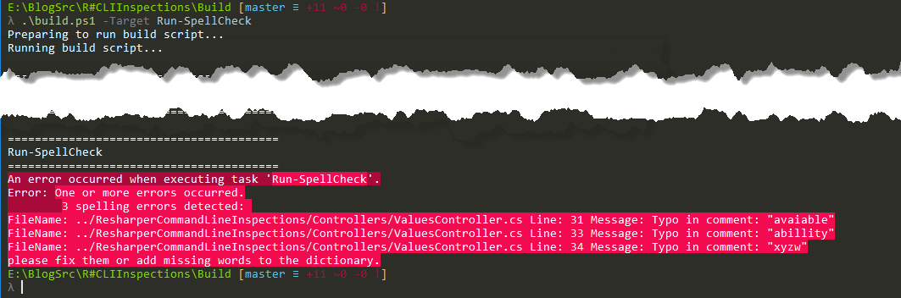

### 1\. Introduction

I tend to do a lot of typos when I write a code and I mean a lot.
This is quite annoying for me so I decided to somehow automate the process of finding the spelling errors during the build.
My first thought was to use some kind of Roslyn analyzer, however, I failed to find any working one.
This is why I decided to give a try to [ReSharper Command Line Tools](https://www.jetbrains.com/help/resharper/ReSharper`Command`Line`Tools.html) (also known as `CLIT`) combined with `ReSpeller` plugin.
For those who don't know, `ReSharper Command Line Tools` is set of tools which allow you to use `ReSharper` inspections without `Visual Studio`

### 2\. First attempt

This was supposed to be a rather straightforward task because according to [documentation](https://www.jetbrains.com/help/resharper/InspectCode.html) command line inspections support extensions out of the box. The example presented in the help page was supposed to be the perfect one for me

```bat frame="none" showLineNumbers=false
InspectCode.exe --project=Documents -o="OutputFile.xml" --no-swea -x=EtherealCode.ReSpeller "SolutionFile.sln"

```

Unfortunately, it turned out that extensions support is broken for [some time](https://youtrack.jetbrains.com/issue/RSRP-436208#comment=27-1078217) and it wasn't working for me either (tested on `Command Line Tools` version `2017.2`).

### 3\. The workaround

Even though extension support is not working as expected I was able to make it work with some workaround.
The workaround itself is a combination of helpful tips taken from this [YouTrack](https://youtrack.jetbrains.com/issue/RSRP-436208#comment=27-1078217) issue.
Long story short, we have to manually install the plugin and then force `ReSharper` to use it.
Assuming that you have command line tools installed this can be achieved in following way.
First of all we have to get our hands on `ReSpeller` plugin. We can install it using `NuGet` but before you do it, remember to add additional feed to `nuget.config` file.

```bash frame="none" showLineNumbers=false
nuget sources add -name JetBrains-Feed -source https://resharper-plugins.jetbrains.com/api/v2/curated-feeds/Wave_v9.0/

```
The feed url can be found in the `ReSharper's` option page and for version 2017.2 it is 

[](//tpodolak.com/blog/wp-content/uploads/2017/10/finding-typos-with-resharper-command-line-tools-respeller-and-cake/ReSharperNuGetFeed.png)

Having our `NuGet` sources updated we can retrieve the package using following command

```bash frame="none" showLineNumbers=false
nuget install "EtherealCode.ReSpeller" -Version "4.6.9.2"

```

The next step is to copy `ReSpeller's` `DLLs` from following folders

```text frame="none" showLineNumbers=false
etherealcode.respeller.4.6.9.2\EtherealCode.ReSpeller\lib\net45\
etherealcode.respeller.4.6.9.2\Extended.Wpf.Toolkit\lib\net40\
etherealcode.respeller.4.6.9.2\NHunspell\lib\net\

```

directly to `CLIT` tools folder - `JetBrains.ReSharper.CommandLineTools\tools`. What is more, `ReSpeller` comes together with dictionary files which also have to be copied to the tools folder.
This time, however, we have to copy entire `etherealcode.respeller.4.6.9.2\EtherealCode.ReSpeller\lib\net45\dic` directory, not only its content.
The very last thing is to make `ReSharper` aware of the plugin, in order to do that we have to find `EtherealCode.ReSpeller.JetMetadata.sstg` file.
The file itself doesn’t come together with the package but it is generated by `ReSharper` during plugin installation.
So the easiest way of getting that file is to install `ReSpeller` as a `ReSharper` plugin in `Visual Studio` and then copy the `sstg` file to tools folder.
After all that work now if you run

```bat frame="none" showLineNumbers=false
InspectCode.exe --project=Documents -o="OutputFile.xml" --no-swea -x=EtherealCode.ReSpeller "SolutionFile.sln"

```

(note lack of `\-x` switch) you will see spellcheck inspections in output file. 

[](//tpodolak.com/blog/wp-content/uploads/2017/10/finding-typos-with-resharper-command-line-tools-respeller-and-cake/OutputXml.png)

### 4\. Cake integration

Doing all that stuff manually is error-prone and time-consuming and of course, I wanted to have the spellcheck up and running on the CI server, that is why I've also automated all above steps with `Cake` build script. The core concept is to use `ReSpeller` and `ReSharper Command Line Tools` as so-called "Cake tools" to run the inspections and `Cake.Issues` and `Cake.Issues.InspectCode` plugins for analyzing the output file. Adding tools and add-ins is straightforward we just have to add following lines on top of the build file.

```csharp
#tool "nuget:?package=EtherealCode.ReSpeller&version=4.6.9.2"
#tool "nuget:?package=JetBrains.ReSharper.CommandLineTools&version=2017.2.2"
#addin "Cake.Issues"
#addin "Cake.Issues.InspectCode"

```

We also have to add `nuget.config` file to our build directory in order to point `Cake` to `ReSharper` feed (you could also modify the global `nuget.config` but I don’t want a build process to change the behavior of entire system)
```xml
<configuration>
    <packageSources>
      <add key="nuget.org" value="https://api.nuget.org/v3/index.json" protocolVersion="3" />
      <add key="resharper-plugins" value="https://resharper-plugins.jetbrains.com/api/v2/curated-feeds/Wave_v9.0/" protocolVersion="2" />
    </packageSources>
</configuration>
```

Before calling `InspectCode.exe` we have to make sure that all of the files and folders exist

```csharp wrap=false
var destinationPath = "tools/jetbrains.resharper.commandlinetools.2017.2.2/JetBrains.ReSharper.CommandLineTools/tools";
Setup(context =>
{
    if(!DirectoryExists(".artifacts"))
    {
        CreateDirectory(".artifacts");
    }

    if(!DirectoryExists(destinationPath + "/dic"))
    {
        CreateDirectory(destinationPath + "/dic");
    }
});
	
Task("Prepare-Respeller")
.Does(()=>
{
    // works for pinned version of ReSpeller
    var destinationPath = "tools/jetbrains.resharper.commandlinetools.2017.2.2/JetBrains.ReSharper.CommandLineTools/tools";
    CopyFiles("tools/etherealcode.respeller.4.6.9.2/EtherealCode.ReSpeller/lib/net45/*.dll", destinationPath);
    CopyFiles("tools/etherealcode.respeller.4.6.9.2/Extended.Wpf.Toolkit/lib/net40/*.dll", destinationPath);
    CopyFiles("tools/etherealcode.respeller.4.6.9.2/NHunspell/lib/net/*.dll", destinationPath);
    CopyFiles("../Spelling/*.dic",  destinationPath + "/dic");
    CopyFiles("../Spelling/*.aff",  destinationPath + "/dic"); // using shared dictionaries not the ReSpeller ones
    CopyFiles("EtherealCode.ReSpeller.JetMetadata.sstg", destinationPath);
});
```

Having all of the items in place now we are ready to run the actual spellcheck and verify the results

```csharp wrap=false
Task("Run-SpellCheck")
.IsDependentOn("Prepare-Respeller")
.Does(() =>
{
    var processArgumentBuilder = new ProcessArgumentBuilder().AppendSwitch("--profile","=","../Spelling/Resharper.ReSpeller.DotSettings")
                                          .AppendSwitch("--caches-home","=","tools")
                                          .AppendSwitch("-o","=","../.artifacts/inspectcode.xml")
                                          .Append("../ResharperCommandLineInspections.sln");

    var processSettings = new ProcessSettings 
    {
        Arguments = processArgumentBuilder,
        Silent = true,
        RedirectStandardOutput = true
    };

    IEnumerable<string> redirectedOutput, redirectedErrors;

    var exitCode = StartProcess(Context.Tools.Resolve("inspectcode.exe"), processSettings, out redirectedOutput, out redirectedErrors);
    if(exitCode !=0)
    {
        throw new CakeException($"InspectCode exited with unexpected error code: {exitCode}");
    }

    var issues = ReadIssues(InspectCodeIssuesFromFilePath("../.artifacts/inspectcode.xml"), "../");
    var spellingIssues = issues.Where(issue => issue.Rule.Contains("Typo")).ToList();

    if(spellingIssues.Any())
    {
        var errorMessage = spellingIssues.Aggregate(new StringBuilder(), (stringBuilder, issue) => stringBuilder.AppendFormat("FileName: {0} Line: {1} Message: {2}{3}", issue.AffectedFileRelativePath, issue.Line, issue.Message, Environment.NewLine));
        throw new CakeException($"{spellingIssues.Count} spelling errors detected: {Environment.NewLine}{errorMessage}please fix them or add missing words to the dictionary.");
    }
});
```

As you can see I start `InspectCode.exe` process with a bunch of parameters.
Once the process returns successful exit code I can go ahead and process the results thanks to `ReadIssues` and `InspectCodeIssuesFromFilePath` methods provided by the add-ins.
Because of the fact that `ReSharper` can produce a ton of inspections I only care about the ones which are typos.
Simple and very naïve `LINQ` query can do it for me

```csharp
var spellingIssues = issues.Where(issue => issue.Rule.Contains("Typo")).ToList();
```

If any typos were found I just throw exception with a listing of all the issues.
Note that I aggregate all the issues into one big message because if you have lots of typos (just like I do) rendering them can take some time

[](//tpodolak.com/blog/wp-content/uploads/2017/10/finding-typos-with-resharper-command-line-tools-respeller-and-cake/Errors.png)

The source code for slightly enhanced version of that script can be found [here](https://github.com/tpodolak/Blog/tree/master/R%23CLIInspections)
