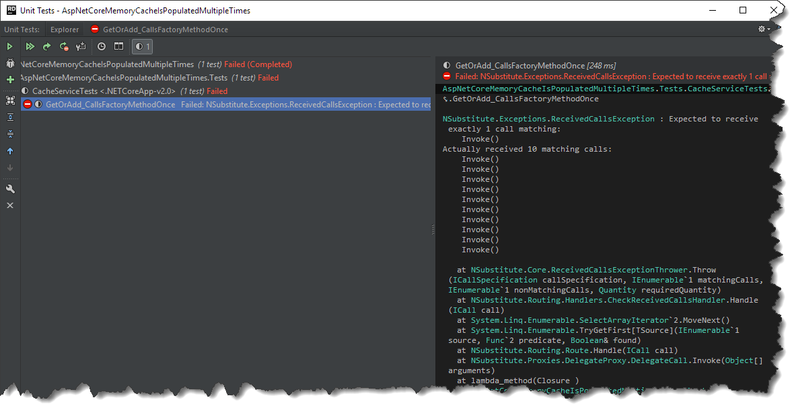

Recently I've been trying to locate a performance issue in our application.
Stress tests have shown an excessive usage of memory combined with too many external server requests.
As usual in such cases, I've run the profiler and after a bit of searching, I've noticed that issue is connected with our caching mechanism.
The problematic part was a factory delegate (responsible for populating cache, if the cache for given key is empty) which was called multiple times when concurrent requests were sent.
That was a bit surprising to me as we basically were using a very naïve wrapper over `ASP.NET Core MemoryCache`.

```csharp
public class CacheService : ICacheService
{
    private readonly IMemoryCache _memoryCache;

    public CacheService(IMemoryCache memoryCache)
    {
        _memoryCache = memoryCache ?? throw new ArgumentNullException(nameof(memoryCache));
    }

    public T GetOrAdd<T>(string cacheKey, Func<T> factory, DateTime absoluteExpiration)
    {
        return _memoryCache.GetOrCreate(cacheKey, entry =>
        {
            entry.AbsoluteExpiration = absoluteExpiration;
            return factory();
        });
    }
}
```

However simple test proved that this was an actual issue

```csharp
[Fact]
public void GetOrAdd_CallsFactoryMethodOnce()
{
    var factoryMock = Substitute.For<Func<string>>();
    var optionsMock = Substitute.For<IOptions<MemoryCacheOptions>>();
    optionsMock.Value.Returns(callInfo => new MemoryCacheOptions());
    var memoryCache = new MemoryCache(optionsMock);

    var subject = new CacheService(memoryCache);

    var threads = Enumerable.Range(0, 10).Select(_ => new Thread(() => subject.GetOrAdd("key", factoryMock, DateTime.MaxValue))).ToList();
            
    threads.ForEach(thread => thread.Start());
    threads.ForEach(thread => thread.Join());

    factoryMock.Received(1)();
}
```

[](//tpodolak.com/blog/wp-content/uploads/2017/12/asp-net-core-memorycache-getorcreate-calls-factory-method-multiple-times/FailedTest.png)

After doing a bit of a digging it turned out that this was by-design behavior, which is documented in the very end of official [documentation](ttps://docs.microsoft.com/en-us/aspnet/core/performance/caching/memory) . However, as this behavior wasn't the one we were expecting, we decided to reduce amount of factory calls by applying custom logic. We had couple of ideas when it comes to implementation, including:

- Exclusive lock over factory method
- Lock per key
- Lock per type

After discussion we decided to go with third option, mainly because we didn't want to over-complicate the design, plus we wanted to allow concurrent factory method calls for different types of objects. Once `CacheService` was updated with following code

```csharp
public class CacheService: ICacheService
{
    private readonly IMemoryCache _memoryCache;

    public CacheService(IMemoryCache memoryCache)
    {
        _memoryCache = memoryCache ?? throw new ArgumentNullException(nameof(memoryCache));
    }

    public T GetOrAdd<T>(string cacheKey, Func<T> factory, DateTime absoluteExpiration)
    {
        // locks get and set internally
        if (_memoryCache.TryGetValue<T>(cacheKey, out var result))
        {
            return result;
        }

        lock (TypeLock<T>.Lock)
        {
            if (_memoryCache.TryGetValue(cacheKey, out result))
            {
                return result;
            }

            result = factory();
            _memoryCache.Set(cacheKey, result, absoluteExpiration);

            return result;
         }
    }    

    private static class TypeLock<T>
    {
        public static object Lock { get; } = new object();
    }
}
```

we stoped experiencing excessive memory usage.

Source code for this post can be found [here](https://github.com/tpodolak/Blog/tree/master/AspNetCoreMemoryCacheIsPopulatedMultipleTimes)
