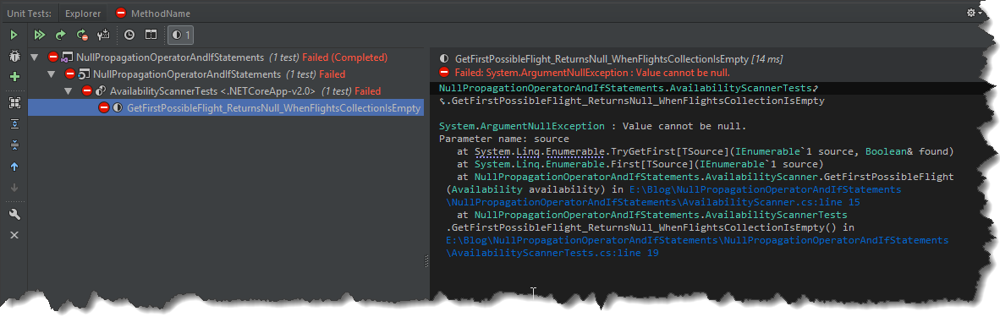

This post is just a quick reminder for me to put a bit more attention to conditional statements combined with a null-propagation operator. Nothing too fancy but I tend to overlook this when doing code review. Starting from C# 6 we can simplify accessing members of an object which might be `null` thanks to `?.` operator. For my perspective it is particularly useful within `if` statements, however, you have to be aware of how compiler rewrites the code under the hood otherwise, it is easy to introduce a bug. Consider following scenario

```csharp
public Flight GetFirstPossibleFlight(Availability availability)
{
    if (availability.Flights?.Any() == false)
    {
       return null;
    }
            
    // more magic in here
     return availability.Flights.First();
}
```

At a glance everything seems to be ok, we make sure that `Flight` collection is not accessed if it is `null`, however simple test shows that this method has a bug.

```csharp
[Fact]
public void GetFirstPossibleFlight_ReturnsNull_WhenFlightsCollectionIsEmpty()
{
    var availability = new Availability
    {
        Flights = null
    };
            
    var subject = new AvailabilityScanner();

    var result = subject.GetFirstPossibleFlight(availability);

    result.Should().BeNull();
}
```

[](http://tpodolak.com/blog/wp-content/uploads/2011/12/silverlight-koncepcja-logowania-z-uzyciem-membershipproviders-oraz-wcf-ria-cz-2/debugger.jpg)

We protected the code from `NullReferenceException` in if statement, however we failed on the return statement.
This happens because our original code is rewritten by compiler as [follows](https://sharplab.io/#v2:CYLg1APgAgDABFAjAFgNwFgBQsGIHQAyAlgHYCOG2AzAgExwCCAbgIZEA2LARh0QC4BPAMoBjFiRIBTAE5YA3ljhKENAGLsiAcwAWfOAHFJfVUWkBnPgAUA9mbNEu7Seq26AFMzaceGwXBasHNy8ggCUisoKmMoxcEQAZnBuAV7BvgJ4Ljp8ZgD8eAwkAm6hcAC8ZXDxLOxmkuHRsUpRTU1QAOxwJACu7OyUrXAAvhGDSqNjAPSTcAC21tKScyyaRCJxJHDaMpITMR3+gd4hGVm6ZpmmFiUDyiOY91hQNFD0Z3zyWI/UdIxHafwBJ9GkpnnBiBYADzvAB8cHeZjgcjgmiMqDgdT46PuQyAA=)

```csharp
public Flight GetFirstPossibleFlight(Availability availability)
{
    List<Flight> expr_07 = availability.Flights;
    bool flag = expr_07 != null && !expr_07.Any<Flight>();
    Flight result;
    if (flag)
    {
        result = null;
    }
    else
    {
        result = availability.Flights.First<Flight>();
    }
    return result;
}
```

Now it is clearly visible that we have to satisfy both of the conditions in order to return `null`.
Fortunately, you still can use one-liner and have a bug-free code, the one thing which is needed is an additional null-coalescing operator in the if statement.

```csharp
public Flight GetFirstPossibleFlight(Availability availability)
{            
    if ((availability.Flights?.Any() ?? false) == false)
    {
        return null;
    }
            
    // more magic in here
    return availability.Flights.First();
}
```
Now the compiler will rewrite the code in a [following way](https://sharplab.io/#v2:CYLg1APgAgDABFAjAFgNwFgBQsGIHQAyAlgHYCOG2AzAgExwCCAbgIZEA2LARh0QC4BPAMoBjFiRIBTAE5YA3ljhKENAGLsiAcwAWfOAHFJfVUWkBnPgAUA9mbNEu7Seq26AFMzaceGwXBasHNy8ggCUisoKmMoxcEQAZnBubgFewb4CeC46fGYA/HgMJAJuoXB5eXDxLOxmkmUAvA1VNXXh0bGdUZ09ylAA7HAkAK7s7JS9MQC+EZNws5MA9ItwALbW0pJrLJpEInEkcNoykgu9A/6B3iGZ2bpmWaYWpRPKM5jvWFA0UPR3fPIsJ9qHRGFd0vwBICOkpvnBiBYADz/AB8cH+ZjgcjgmiMqDgdT4+PeUyAA=)
```csharp
public Flight GetFirstPossibleFlight(Availability availability)
{
    List<Flight> expr_07 = availability.Flights;
    bool flag = expr_07 == null || !expr_07.Any<Flight>();
    Flight result;
    if (flag)
    {
        result = null;
    }
    else
    {
        result = availability.Flights.First<Flight>();
    }
    return result;
}
```
Notice that `AND` operator was replaced with `OR` operator, resulting in code safe from `NullReferenceException`.
Source code for this post can be found [here](https://github.com/tpodolak/Blog/tree/master/NullPropagationOperatorAndIfStatements)
