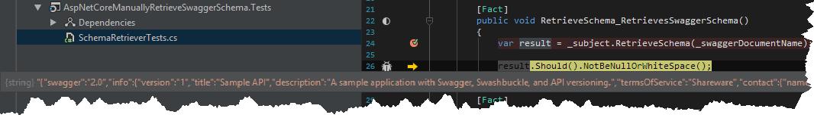
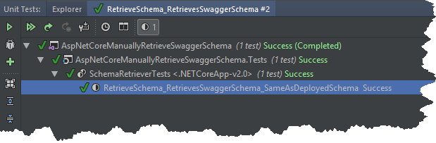

### 1\. Introduction

I am currently exploring possible ways of removing a repetitive work when it comes to creating integration tests for our `API`.
The one thing which usually takes some time when testing a new endpoint is a process of creating response and request classes (as we don't share the models between API project and integration test project).
That is why I would like to have some kind of a tool (`AutoRest` or `NSwag`) which would do it for us (possibly, in a prebuild step).
As those tools generate `API` clients based on swagger specification and I wanted this process to be as fast as possible I decided to figure out the way how to retrieve swagger specs without hosting the `API`.

### 2\. Implementation

After taking a look at `Swashbuckle.AspNetCore.Swagger` source code it turned out that `Swashbuckle.AspNetCore.Swagger.ISwaggerProvider` is responsible for creating a `SwaggerDocument` class.
`JSON` representation of that class is a swagger specification.
Having all of that in mind I wrote following piece of code.

```csharp
public class SchemaRetriever
{
    private readonly Lazy<IWebHost> _webHostProxy = new Lazy<IWebHost>(() => Program.BuildWebHost(new string[0]));

    private IWebHost WebHost => _webHostProxy.Value;
        
    public string RetrieveSchema(string swaggerDocument)
    {
        using (var scope = WebHost.Services.CreateScope())
        {
            var serviceProvider = scope.ServiceProvider;
            var swaggerProvider = serviceProvider.GetRequiredService<ISwaggerProvider>();
            var mvcJsonOptions = serviceProvider.GetRequiredService<IOptions<MvcJsonOptions>>();
            var document = swaggerProvider.GetSwagger(swaggerDocument, null, "/");

            var serializer = new JsonSerializer
                {
                    NullValueHandling = NullValueHandling.Ignore,
                    Formatting = mvcJsonOptions.Value.SerializerSettings.Formatting,
                    ContractResolver = new SwaggerContractResolver(mvcJsonOptions.Value.SerializerSettings)
                };

            using (var stringWriter = new StringWriter())
            {
                serializer.Serialize(stringWriter, document);
                return stringWriter.ToString();
            }   
        }
    }
}

public class Program
{
    public static void Main(string[] args)
    {
        BuildWebHost(args).Run();
    }

    public static IWebHost BuildWebHost(string[] args) =>
            WebHost.CreateDefaultBuilder(args)
                .UseStartup<Startup>()
                .Build();
}
```

The `Program` class is an entry point of the `API`. The only one difference compared to default `ASP.NET Core` template is the fact that I made the `BuildWebHost` method public.
Thanks to that we can build the host (but without running) and get our hands on the `DI` container of our application.
From that point the rest is easy, I retrieve the `ISwaggerProvider` from the container so I can get the swagger document for given id.

[](//tpodolak.com/blog/wp-content/uploads/2018/01/asp-net-core-retrieving-swagger-specification-without-hosting-api/TestWithoutHosting.png)

In order to make sure that the `SchemaRetriever` works as expected I wrote simple integration test which makes sure that swagger specs from hosted `API` is the same as the one retrieved without hosting.

```csharp
[Fact]
public async Task RetrieveSchema_RetrievesSwaggerSchema_SameAsDeployedSchema()
{
    var swaggerSchemaWithoutHosting = _subject.RetrieveSchema(_swaggerDocumentName);
    using (var testServer = new TestServer(new WebHostBuilder().UseStartup<Startup>()))
    {
        using (var httpClient = testServer.CreateClient())
        {
            var response = await httpClient.GetAsync($"swagger/{EscapeDataString(_swaggerDocumentName)}/swagger.json");
            response.EnsureSuccessStatusCode();
            var content = await response.Content.ReadAsStringAsync();

            swaggerSchemaWithoutHosting.Should().Be(content);
        }
    }
}
```

[](//tpodolak.com/blog/wp-content/uploads/2018/01/asp-net-core-retrieving-swagger-specification-without-hosting-api/IntegrationTest.png) 

Source code for this post can be found [here](https://github.com/tpodolak/Blog/tree/master/AspNetCoreManuallyRetrieveSwaggerSchema)
