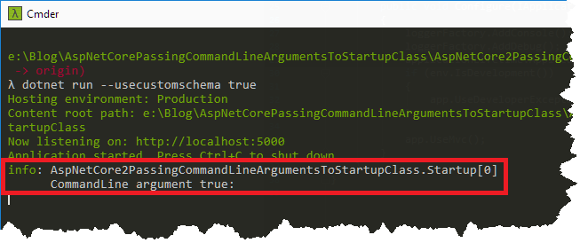
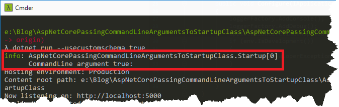

### 1\. Introduction

I usually pass configuration to my web API via JSON files, but recently I needed to pass them also via command-line arguments. As the solution for `ASP.NET Core 2.x` is quite different than for `ASP.NET Core 1.x` I decided to describe both methods in here.

### 2\. ASP.NET Core 2.x

For the newest version of `ASP.NET Core`, the solution is pretty straightforward as `IConfiguration` is injected by default to the `Startup` class. All we have to do is to add `CommandLineConfigurationSource` to `IConfigurationBuilder` when configuring `IWebHost`. `CommandLineConfigurationSource` is part of the `Microsoft.Extensions.Configuration.CommandLine` package and can be easily used by `AddCommandLine` extension method

```csharp
public class Program
{
    public static void Main(string[] args)
    {
        BuildWebHost(args).Run();
    }
	
    public static IWebHost BuildWebHost(string[] args)
    {
        var webHost = new WebHostBuilder()
	     .UseKestrel()
	     .UseContentRoot(Directory.GetCurrentDirectory())
	     .ConfigureAppConfiguration((hostingContext, config) =>
	     {
	         var env = hostingContext.HostingEnvironment;
	         config.AddJsonFile("appsettings.json", optional: true, reloadOnChange: true)
	               .AddJsonFile($"appsettings.{env.EnvironmentName}.json", optional: true, reloadOnChange: true);
	         config.AddEnvironmentVariables();
	         config.AddCommandLine(args);
	     }).UseStartup()
	       .Build();
        return webHost;
    }
}

```

Now we can access our command-line arguments just like any other configuration

```csharp
public class Startup
{
    private readonly IConfiguration _configuration;

    public Startup(IConfiguration configuration)
    {
        _configuration = configuration;
    }

    // This method gets called by the runtime. Use this method to add services to the container.
    public void ConfigureServices(IServiceCollection services)
    {
        services.AddMvc();
    }

    // This method gets called by the runtime. Use this method to configure the HTTP request pipeline.
    public void Configure(IApplicationBuilder app, IHostingEnvironment env, ILoggerFactory loggerFactory, IApplicationLifetime applicationLifetime)
    {
        loggerFactory.AddConsole();
        loggerFactory.AddDebug();
        applicationLifetime.ApplicationStarted.Register(() => loggerFactory.CreateLogger().LogInformation("CommandLine argument {0}: ", _configuration["usecustomschema"]));
        if (env.IsDevelopment())
        {
            app.UseDeveloperExceptionPage();
        }

        app.UseMvc();
    }
}

```

[](//tpodolak.com/blog/wp-content/uploads/2018/01/asp-net-core-passing-command-line-arguments-to-startup-class/AspNetCore2CommandLineArgument-1.png)

### 3\. ASP.NET Core 1.x

The solution for `ASP.NET Core 1.x` requires a bit more work but it is possible to achieve the same result. We still will be using `CommandLineConfigurationSource` from `Microsoft.Extensions.Configuration.CommandLine` package, however this time we have to manually create `IConfiguration` object and register it in the container before the `Startup` class is created. This is possible because the `WebHostBuilder` exposes `ConfigureServices` method.

```csharp
public class Program
{
    public static void Main(string[] args)
    {
        var host = new WebHostBuilder()
             .UseKestrel()
             .UseContentRoot(Directory.GetCurrentDirectory())
             UseIISIntegration()
             .ConfigureServices(serviceCollection =>
                 serviceCollection.AddSingleton(new ConfigurationBuilder().AddCommandLine(args).Build()))
             .UseStartup()
             .Build();

          host.Run();
    }
}

```

Having our service registered now we can easily access `IConfiguration` object in our application

```csharp
public class Startup
{
    // This method gets called by the runtime. Use this method to add services to the container.
    public void ConfigureServices(IServiceCollection services)
    {
        // Add framework services.
        services.AddMvc();
    }

    // This method gets called by the runtime. Use this method to configure the HTTP request pipeline.
    public void Configure(IApplicationBuilder app, IHostingEnvironment hostingEnvironment, IConfiguration configuration, ILoggerFactory loggerFactory, IApplicationLifetime applicationLifetime)
    {
        loggerFactory.AddConsole();
        loggerFactory.AddDebug();
        applicationLifetime.ApplicationStarted.Register(() =>
                loggerFactory.CreateLogger().LogInformation("CommandLine argument {0}: ", configuration["usecustomschema"]));

        if (hostingEnvironment.IsDevelopment())
        {
            app.UseDeveloperExceptionPage();
        }

        app.UseMvc();
    }
}

```

[](//tpodolak.com/blog/wp-content/uploads/2018/01/asp-net-core-passing-command-line-arguments-to-startup-class/AspNetCoreCommandLineArgument-1.png)

Source code for this post can be found [here](https://github.com/tpodolak/Blog/tree/master/AspNetCorePassingCommandLineArgumentsToStartupClass)
