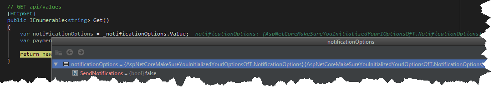
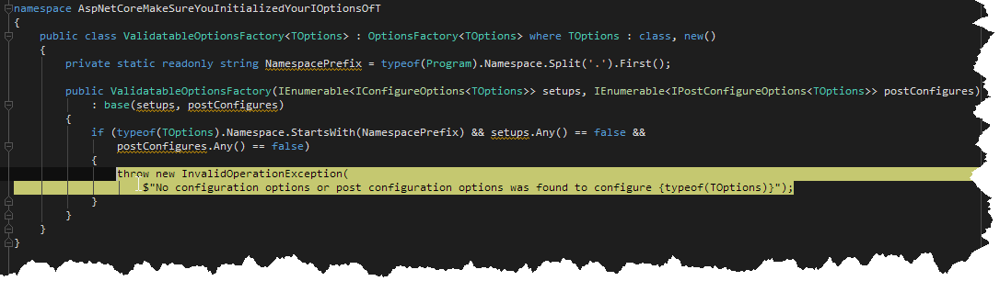
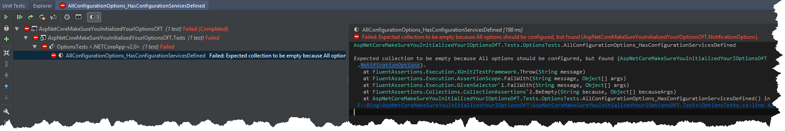

### 1\. Introduction

As most people know `IOptions<T>` is a convenient way of handling configuration options in your application.
Even though I've been using it for quite some time, last week I was unpleasantly surprised by a production bug caused by wrong usage of this mechanism.

### 2\. Problem

Let's say we have a simple controller which depends on two instances of `IOptions<T>`

```csharp
[Route("api/[controller]")]
public class ValuesController : Controller
{
    private readonly IOptions<PaymentOptions> _paymentOptions;
    private readonly IOptions<NotificationOptions> _notificationOptions;

    public ValuesController(IOptions<PaymentOptions> paymentOptions, IOptions<NotificationOptions> notificationOptions)
    {
        _paymentOptions = paymentOptions ?? throw new ArgumentNullException(nameof(paymentOptions));
        _notificationOptions = notificationOptions ?? throw new ArgumentNullException(nameof(notificationOptions));
    }

    // GET api/values
    [HttpGet]
    public IEnumerable<string> Get()
    {
        var notificationOptions = _notificationOptions.Value;
        var paymentOptions = _paymentOptions.Value;
            
        return new string[] {"value1", "value2"};
    }
}
```

Then we add only `IOptions` in Startup class - `IOptions<PaymentOptoins>`

```csharp
public class Startup
{
    // Rest of the code omitted for brevity
    // This method gets called by the runtime. Use this method to add services to the container.
    public void ConfigureServices(IServiceCollection services)
    {
        services.AddOptions();
        services.AddMvc();
        services.Configure<PaymentOptions>(Configuration.GetSection("PaymentOptions"));
    }
      // Rest of the code omitted for brevity
}
```

Now, when we run the app and hit one of the endpoints in `ValuesController` I was expecting to get an exception, as I didn't register `IOptions<NotificationOptions>`.
Surprisingly for me, the application was running normally and `IOptions<NotificationOptions>` was created with the new instance of `NotificationOptions` class(with all the properties defaulted).

[](//tpodolak.com/blog/wp-content/uploads/2018/01/asp-net-core-make-sure-your-ioptions-is-initialized/NotInitialized.png)

In order to find out why it behaves like that we have to take a look how services responsible for handling `IOptions<T>` are registered in the container.

```csharp wrap=false
public static IServiceCollection AddOptions(this IServiceCollection services)
{
    if (services == null)
        throw new ArgumentNullException(nameof (services));

    services.TryAdd(ServiceDescriptor.Singleton(typeof (IOptions<>), typeof (OptionsManager<>)));
    services.TryAdd(ServiceDescriptor.Scoped(typeof (IOptionsSnapshot<>), typeof (OptionsManager<>)));
    services.TryAdd(ServiceDescriptor.Singleton(typeof (IOptionsMonitor<>), typeof (OptionsMonitor<>)));
    services.TryAdd(ServiceDescriptor.Transient(typeof (IOptionsFactory<>), typeof (OptionsFactory<>)));
    services.TryAdd(ServiceDescriptor.Singleton(typeof (IOptionsMonitorCache<>), typeof (OptionsCache<>)));
    return services;
}
```

As you can see `AddOptions` method registers open generics for (among others) `IOptions<>` which means that you don’t have to register specific types of `IOptions<T>`, however, you are responsible for its configuration with

```csharp
services.Configure<T>(Configuration.GetSection("Section"));
```

I was always convinced that `services.Configure` registers and configure `IOptions<T>` but apparently, I was wrong.

### 3\. Ensuring initialization

As these kind of errors are rather difficult to catch(at least in case of our application) I wanted to minimize the risk of doing the same bug again.
The idea was to make sure that at least one `IConfigureOptions<T>` or `IPostConfigureOptions<T>` service is registered in the container (as these are the services which are responsible for setting the values of `T` class).
My first approach was to replace default `OptionsFactory<T>` with a custom one

```csharp
public class ValidatableOptionsFactory<TOptions> : OptionsFactory<TOptions> where TOptions : class, new()
{
    private static readonly string NamespacePrefix = typeof(Program).Namespace.Split('.').First();

    public ValidatableOptionsFactory(IEnumerable<IConfigureOptions<TOptions>> setups, IEnumerable<IPostConfigureOptions<TOptions>> postConfigures)
            : base(setups, postConfigures)
    {
        if (typeof(TOptions).Namespace.StartsWith(NamespacePrefix) && setups.Any() == false && postConfigures.Any() == false)
        {
            throw new InvalidOperationException($"No configuration options or post configuration options was found to configure {typeof(TOptions)}");
        }
    }
}

public class Startup
{      
    // This method gets called by the runtime. Use this method to add services to the container.
    public void ConfigureServices(IServiceCollection services)
    {
        services.AddTransient(typeof(IOptionsFactory<>), typeof(ValidatableOptionsFactory<>));
        services.AddOptions();
    }
}
```

This method works fine (although probably needs smarter `TOptions` filter)

[](//tpodolak.com/blog/wp-content/uploads/2018/01/asp-net-core-make-sure-your-ioptions-is-initialized/ValidatableOptionsFactory.png)

however I got to conclusion that there is no point to do validation in a runtime, and the integration test might be a better choice.
I came up with following code (I am assuming that all configuration options are stored in the same assembly, as this is convention in my project)

```csharp wrap=false
public class OptionsTests
{
    private readonly Lazy<IWebHost> _webHost = new Lazy<IWebHost>(Program.BuildWebHost(null));

    // this test will fail as not every option in assembly is configured
    [Fact]
    public void AllConfigurationOptions_HasConfigurationServicesDefined()
    {
        var optionsType = typeof(IOptions<>);
        var constructorParameterTypes = typeof(Program).Assembly.GetExportedTypes()
                .SelectMany(type => type.GetConstructors().SelectMany(ctor => ctor.GetParameters()))
                .Select(parameter => parameter.ParameterType);

        var optionValueTypes = constructorParameterTypes.Where(parameterType => IsAssignableToGenericType(parameterType, optionsType))
                .Select(options => options.GetGenericArguments().Single())
                .Distinct();
            
        var postConfigureOptionsType = typeof(IPostConfigureOptions<>);
        var configureOptionsType = typeof(IConfigureOptions<>);

        var postConfiguration = optionValueTypes.Select(type => new
        {
            optionsType = type,
            configureOptionsType = _webHost.Value.Services.GetServices(configureOptionsType.MakeGenericType(type)),
            postConfigureServices = _webHost.Value.Services.GetServices(postConfigureOptionsType.MakeGenericType(type))
        });

        var emptyConfigurations =
                postConfiguration.Where(item => item.configureOptionsType.Any() == false && item.postConfigureServices.Any() == false)
                    .Select(item => item.optionsType);

        emptyConfigurations.Should().BeEmpty("All options should be configured");
    }

    // https://stackoverflow.com/questions/74616/how-to-detect-if-type-is-another-generic-type/1075059#1075059
    public static bool IsAssignableToGenericType(Type givenType, Type genericType)
    {
        var interfaceTypes = givenType.GetInterfaces();

        if (interfaceTypes.Any(it => it.IsGenericType && it.GetGenericTypeDefinition() == genericType))
        {
            return true;
        }

        if (givenType.IsGenericType && givenType.GetGenericTypeDefinition() == genericType)
            return true;

        var baseType = givenType.BaseType;
        if (baseType == null) return false;

        return IsAssignableToGenericType(baseType, genericType);
    }
}
```

Running the test shows that `NotificationOptions` was not configured


[](//tpodolak.com/blog/wp-content/uploads/2018/01/asp-net-core-make-sure-your-ioptions-is-initialized/Test.png)

Source code for this post can be found [here](https://github.com/tpodolak/Blog/tree/master/AspNetCoreMakeSureYouInitializedYourIOptionsOfT)
