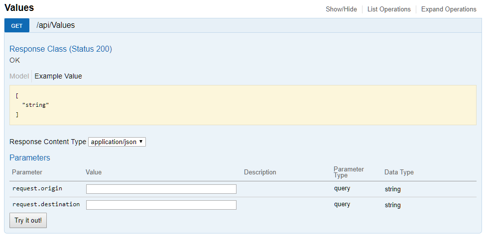
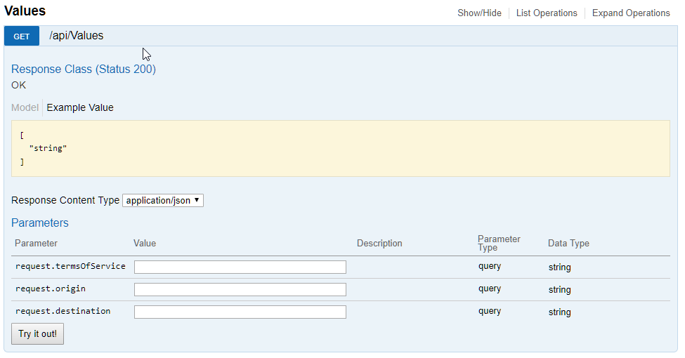

Last week I've encountered an interesting bug in swagger documentation of our API. For some reason couple of _Get_ operations were missing some of the query parameters. The issue itself was only visible in a couple of controllers, simplified version of one of them is shown below

```
public class ValuesController : ApiController
{
    // GET api/values
    public IEnumerable Get([FromUri] FullAvailabilityRequest request)
    {
        return new string[] {"value1", "value2"};
    }
}

```

As you can see the controller has a Get method which takes as an argument following class

```
public class FullAvailabilityRequest : AvailabilityRequest
{
    public string TermsOfService { get; set; }
}

[DataContract]
public class AvailabilityRequest
{
    [DataMember]
    public string Origin { get; set; }

    [DataMember]
    public string Destination { get; set; }
}

```

If you run swagger for _Get_ operation you will see that only two parameters are listed in a parameter list [](//tpodolak.com/blog/wp-content/uploads/2018/04/asp-net-web-api-2-missing-swagger-query-parameters/MissingParameter.png) After some digging I found the actual problem were basically _\[DataMember\]_ and _\[DataContract\]_ attributes randomly scattered in the models used in _Get_ methods arguments. Even though these attributes are not used for model binding from the query string, swagger takes them into account either way. It happens basically because swagger under the hood uses _JsonObjectContract_ (even for \[FromUri\] request classes) and by default it respects _\[DataContract\]_ attribute - more info can be found [here](http://james.newtonking.com/archive/2009/10/23/efficient-json-with-json-net-reducing-serialized-json-size). Removing redundant _\[DataContract\]_ and _\[DataMember\]_ attributes from respective models solved the issue. [](//tpodolak.com/blog/wp-content/uploads/2018/04/asp-net-web-api-2-missing-swagger-query-parameters/FixedMissingParameter.png)

PS. This particular corner case is not an issue for _ASP.NET Core_ swagger implementation.
