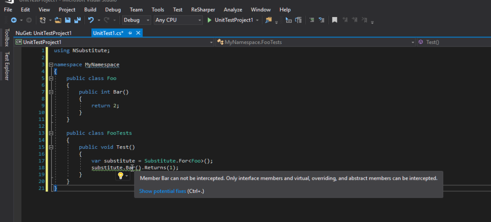
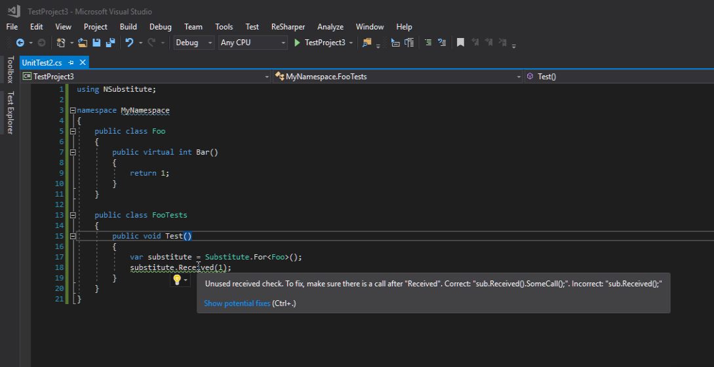

### 1\. Introduction

I am glad to announce that yesterday, together with _NSubstitute_ team we released first beta version of _Roslyn_ analyzers for NSubstitute - [NSubstitute.Analyzers](https://github.com/nsubstitute/NSubstitute.Analyzers). The analyzers come in two flavors: [NSubstitute.Analyzers.CSharp](https://www.nuget.org/packages/NSubstitute.Analyzers.CSharp) and [NSubstitute.Analyzers.VisualBasic](https://www.nuget.org/packages/NSubstitute.Analyzers.VisualBasic). Feel free to grab them from NuGet and try them in your project.

### 2\. Diagnostics

As for today analyzers can detect two most common misusages of _NSubstitute_:

- non-virtual call setup
- Received used without following method call

Feels free to [suggest](https://github.com/nsubstitute/NSubstitute.Analyzers/issues) additional diagnostic you would like to have in the package.
