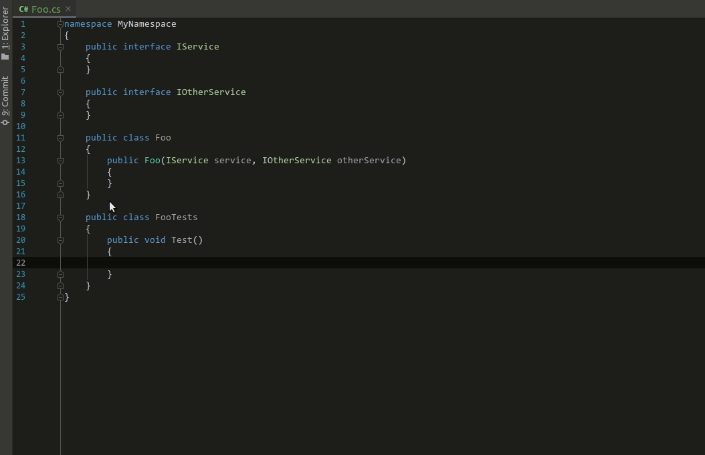
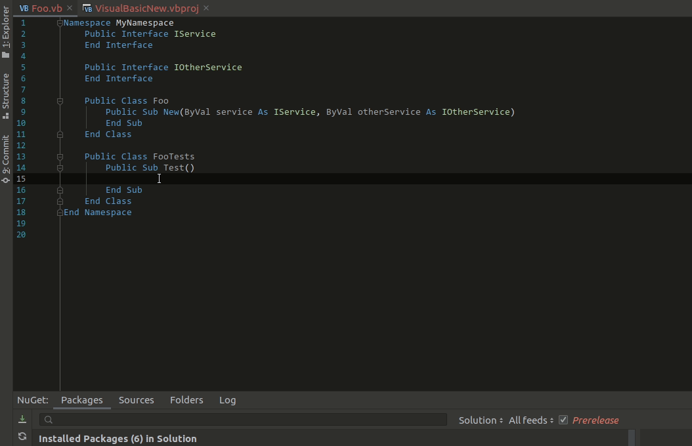

I am glad to announce the newest version of [NSubstitute.Analyzers](https://www.nuget.org/packages/NSubstitute.Analyzers.CSharp/1.0.13) comes with "introduce substitute" refactoring, which allows you to automatically create substitutes for constructor arguments as fields or local variables.
As an image is worth a thousand words here is a quick demo of `C#` version

and VisualBasic one

